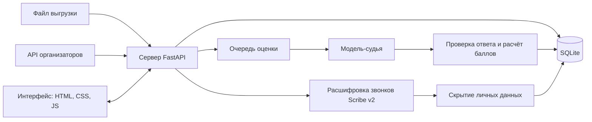

DataAvengers проверяет чаты и звонки поддержки Freedom Broker по чек-листу качества. Модель отвечает по каждому критерию, объясняет ответ и приводит цитаты из разговора. Сервер сам считает баллы. Аналитик может оспорить оценку, проверяющий решает спор, итог пересчитывается, а исходная оценка сохраняется в истории.

Сделано на хакатоне Freedom Broker CQA командой DataAvengers.

## Как это выглядит

**Реестр обращений.** Номер, дата, язык, канал и короткая тема разговора. При наведении на итог видно, из чего он сложился.


**Карточка обращения.** Слева разговор, справа оценка. Наведение на критерий подсвечивает реплики, на которых основан ответ. Клик по цитате прокручивает к нужному сообщению, у звонка перематывает запись.


**Рабочее место проверяющего.** Очередь споров сверху, фрагмент разговора слева, правило критерия, ответ модели, довод аналитика и решение справа. Новый итог виден до сохранения.


**Чек-лист.** Открывается как документ: правила, доля каждого критерия в итоге, история версий. Редактор ведёт по шагам и показывает изменения перед сохранением.


**Сводка.** Выполнение критериев по языкам и рейтинг операторов.


## Что умеет

| Задача кейса | Как сделано |
| --- | --- |
| Настройка чек-листа | Добавление, удаление и правка критериев, тип ответа (да или нет, шкала, отметка нарушения), вес, условие «не применяется». Каждое сохранение создаёт новую версию. |
| Оценка диалога | По одному вызову модели на критерий. Ответ, объяснение и цитаты проверяются сервером: ответ должен быть допустимым, цитата должна быть в разговоре. |
| Результат | Ответ, баллы, вес, объяснение и реплика-доказательство по каждому критерию. Для пропущенного действия отмечен участок, где его ждали. Для «не применимо» указана причина. |
| Вес и итог | Баллы считает сервер. Вес неприменимых критериев делится между остальными пропорционально. Итог округляется до двух знаков половиной вверх. Грубая ошибка отмечается отдельно и на итог не влияет. |
| Карточка | Переход от цитаты к сообщению, свой плеер звонка с перемоткой к реплике. |
| Апелляция и решение | Аналитик оспаривает критерий с комментарием, проверяющий подтверждает или меняет ответ с причиной. Видны исходная оценка, решение и финальный итог. |
| Замена критерия | Новая версия применяется к обращениям, модель заново оценивает только изменённые критерии. Таблица «было и стало» показывает, как сдвинулись итоги. |

Сверх кейса:

- лента весов: итог виден полосой из критериев, перераспределение веса понятно без слов;
- пакетная оценка с живым прогрессом по строкам;
- отметка «стоит проверить», если модель ответила по-разному при двух проверках;
- синхронизация обращений из CRM без дублей и загрузка выгрузки файлом;
- своя расшифровка звонков: точнее разделяет говорящих и даёт время каждого слова;
- скрытие личных данных в расшифровке: ИИН, телефоны, карты, коды, адреса, имена;
- резюме разговора, перевод реплик на русский, казахский и английский, советы оператору;
- интерфейс на трёх языках;
- выгрузка результатов в CSV и JSON.

## Как устроено



- **Интерфейс**: обычные HTML, CSS и JavaScript без сборки и библиотек. Каждый экран открывается по своему адресу, поэтому его можно встроить веб-ресурсом Dynamics 365. Подробно в [web/README.md](web/README.md).
- **Сервер**: Python, FastAPI, SQLite. Очередь оценок с частичными результатами, повтор упавшего критерия, переиспользование ответов при новой версии чек-листа. Подробно в [backend/README.md](backend/README.md).
- **Модели** через OpenRouter: расшифровка звонков `elevenlabs/scribe-v2`, перевод `google/gemini-3.1-flash-lite`.

## Запуск

Нужен Python 3.10 или новее. Для проверки полноты записей звонков желательны `ffmpeg` и `ffprobe` в `PATH`.

```powershell
git clone https://github.com/zzhassyn/data-freedom.git
cd data-freedom\backend
python -m venv .venv
.\.venv\Scripts\python.exe -m pip install -r requirements.txt
Copy-Item .env.example .env
.\.venv\Scripts\python.exe -m uvicorn app.main:app --port 8000
```

Откройте http://localhost:8000. База и начальный чек-лист создаются сами. Обращения загружаются кнопкой «Загрузить»: файлом ([DEV из репозитория](backend/tests/data/dev.json)) или вкладкой «Из CRM».

Для расшифровки звонков и перевода впишите ключ OpenRouter в `backend/.env`:

```dotenv
OPENROUTER_API_KEY=ваш_ключ
```

Без сервера интерфейс тоже открывается: `python -m http.server 5500 --directory web` из корня репозитория. В этом режиме работают встроенные 65 обращений и пять подготовленных оценок, данные хранятся в браузере.

## Стоимость

| Операция | Модель | Цена |
| --- | --- | --- |
| Расшифровка звонка | `elevenlabs/scribe-v2` | около 2,5 цента за звонок DEV, $0,22 за час записи |
| Перевод разговора | `google/gemini-3.1-flash-lite` | по фактическому расходу OpenRouter |

Пять звонков DEV расшифрованы за $0,128. Фактические расходы видны в `GET /api/health` (`totalCostUsd`).

## Личные данные

При расшифровке запись звонка уходит через OpenRouter в ElevenLabs. Сервер скрывает в тексте ИИН, телефоны, карты, личную почту, коды из СМС, адреса и имена, которые скрыты у организаторов. Сырые ответы не сохраняются, временный аудиофайл удаляется. Оценка всегда идёт по исходному транскрипту организаторов.

Сервер принимает изменяющие запросы только в JSON и только со своего адреса, а записи звонков скачивает только с разрешённых хостов организаторов.

## Контрольный набор

1. «Загрузить», вкладка «Из CRM», «Настройки источника»: вписать выданный набор и синхронизировать.
2. «Оценить все без оценки» в реестре.
3. «Чек-лист», «Изменить», заменить критерий, сохранить и применить к обращениям.
4. Проверить таблицу «было и стало».

Сценарий показа по минутам в [docs/demo.md](docs/demo.md).

## Проверки

```powershell
cd backend
.\.venv\Scripts\python.exe -m pytest -q
```

Что проверено вручную в интерфейсе, описано в [web/TESTING.md](web/TESTING.md).
