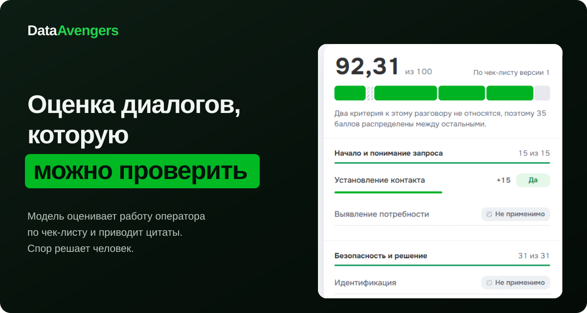
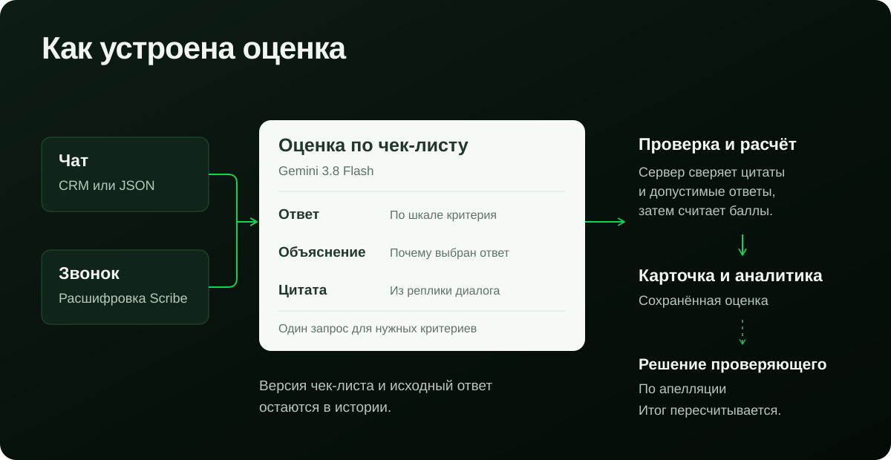
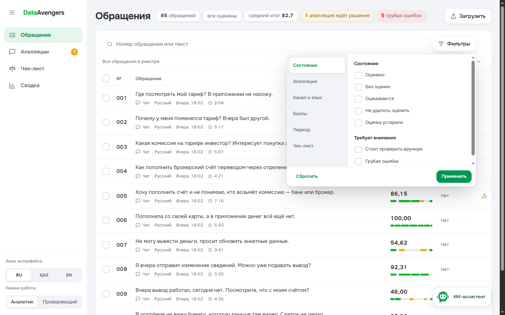
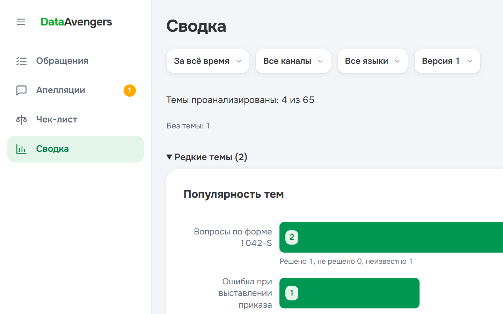
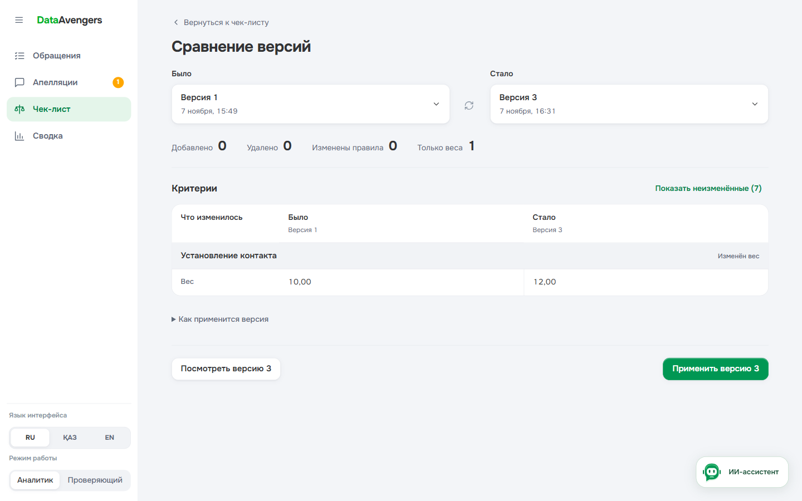
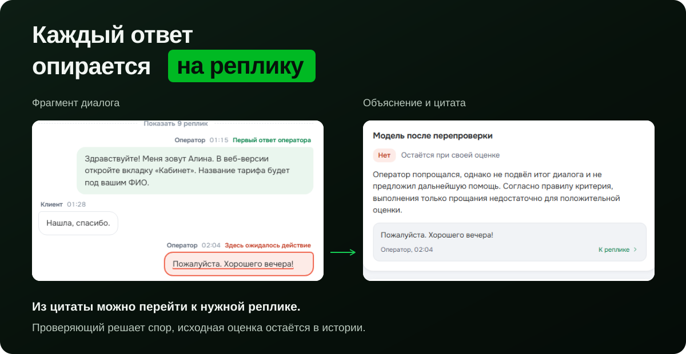
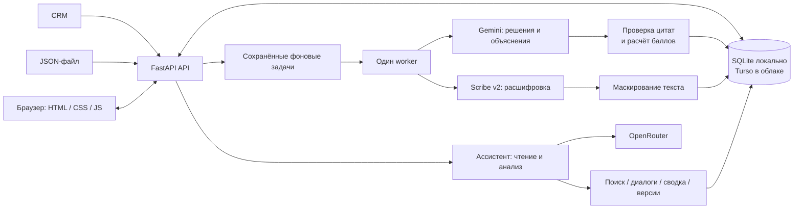

<div align="center">
  <a href="https://data-freedom.vercel.app">
    
  </a>
  
  <p>
    <a href="https://data-freedom.vercel.app"><strong>Открыть демо</strong></a>
    &nbsp;&nbsp; <a href="#local-run">Запустить локально</a>
    &nbsp;&nbsp; <a href="#self-deploy">Развернуть свою версию</a>
    &nbsp;&nbsp; <a href="docs/accuracy.md">Методика и результаты</a>
  </p>
</div>

DataAvengers помогает контролировать качество поддержки Freedom Broker. Приложение собирает чаты и звонки, оценивает их по настраиваемому чек-листу и связывает каждый ответ с правилом, объяснением и фрагментом разговора. Аналитик разбирает проблемные обращения, проверяющий рассматривает апелляции, а руководитель видит темы, качество и конкретные диалоги за каждым показателем.

Модель формирует ответы и объяснения. Сервер проверяет формат и цитаты, рассчитывает баллы и хранит историю. Решение по спорной оценке принимает человек.

## Содержание

| Продукт и результаты | Запуск и эксплуатация |
| --- | --- |
| [От обращения до решения](#workflow) | [Архитектура](#architecture) |
| [Реестр, карточка, ассистент и сводка](#features) | [Локальный запуск на Windows, Linux и macOS](#local-run) |
| [Чек-листы, апелляции, импорт и языки](#checklists) | [Своя установка Vercel и Turso](#self-deploy) |
| [Правила и формула оценки](#evaluation) | [Запуск на собственном сервере](#own-server) |
| [Совпадение с разметкой команды](#quality) | [Расходы и работа с данными](#data-and-cost) |
| [Результаты по каждому критерию](#criterion-results) | [Проверки и устройство репозитория](#verification) |

<a id="workflow"></a>
## От обращения до решения



| Кто работает | Что делает | Что остаётся после работы |
| --- | --- | --- |
| Аналитик качества | Выбирает обращения, проверяет цитаты, запускает оценку, оспаривает ответ модели | Оценка с основаниями, комментарий к апелляции, точная группа обращений для разбора |
| Проверяющий | Сопоставляет правило, разговор и довод аналитика; подтверждает или меняет ответ | Решение с причиной, пересчитанный итог и сохранённый исходный ответ |
| Руководитель поддержки | Изучает темы, слабые критерии, результаты операторов и изменения за период | Переход от показателя к диалогам, на которых он рассчитан |

Обычный сценарий занимает несколько переходов:

1. **Загрузить данные** из CRM или JSON. Импорт сообщает, какие обращения новые, обновлены или уже были в базе.
2. **Собрать выборку** по языку, каналу, датам, баллам, состоянию оценки и апелляции.
3. **Открыть обращение** и проверить ответ по цитате или прослушать нужный фрагмент звонка.
4. **Разобрать расхождение** с помощью ассистента или отправить критерий на апелляцию.
5. **Перейти в сводку**, найти повторяющуюся проблему и открыть все связанные обращения.
6. **Уточнить чек-лист**, сравнить версии и отдельно выбрать, к каким обращениям применить новые правила.

<a id="features"></a>
## Возможности

### Реестр: найти нужные обращения

В реестре видны номер, дата, язык, канал, тема, итоговая оценка и состояние апелляции. Наведение на итог раскрывает вклад критериев. Отсутствие апелляции обозначено словом **«Нет»**, поэтому пустая ячейка не требует догадок.


<details>
<summary>Фильтры реестра</summary>



</details>

| Инструмент | Поведение |
| --- | --- |
| Поиск | По номеру и тексту обращения |
| Фильтры | Язык, чат или звонок, состояние оценки, грубые ошибки, необходимость проверки и состояние апелляции |
| Диапазоны | Нижняя и верхняя граница балла, начальная и конечная дата |
| Версия чек-листа | Баллы и выборка относятся к выбранной версии; результаты разных правил не смешиваются незаметно |
| Панель условий | Компактное окно рядом с кнопкой фильтров: группы слева, условия выбранной группы справа; кнопки сброса и применения |
| Переходы из сводки | Сводка и ассистент открывают конкретную группу обращений с сохранением её состава |
| Пакетный выбор | Отдельные строки, диапазон с Shift, страница или все обращения по условиям |
| Обработка | Настоящий прогресс задачи, готовые и ошибочные результаты, отдельный повтор ошибок |

Применённые условия видны отдельными метками. Нажатие на метку открывает её группу для изменения, а крестик снимает условие. Пакетная задача продолжает отображаться после перехода на другой экран или перезагрузки страницы. Скрытие уведомления не отменяет обработку. При изменении исходного разговора прежняя оценка остаётся в истории, но помечается устаревшей.

### Карточка: проверить, откуда взялся балл

Разговор и оценка расположены рядом. В транскрипте сохранены роли, системные события и ожидание ответа. Справа находятся итог, версия чек-листа, распределение веса и критерии с объяснениями.


- **Цитата ведёт к источнику.** Нажатие прокручивает разговор к нужной реплике; у звонка можно перейти к соответствующему времени записи.
- **Пропуск тоже имеет основание.** Для невыполненного действия показывается проверенный участок, где оно ожидалось.
- **Неприменимость объясняется.** Видны причина и изменение долей оставшихся критериев.
- **Плеер связан с репликами.** Доступны волна записи, скорость воспроизведения, перемотка и управление с клавиатуры.
- **История сохраняет контекст.** Прежняя оценка открывается вместе с тем транскриптом и версией правил, по которым была получена.
- **Ошибка остаётся заметной.** Устаревшая, незавершённая или неудачная оценка имеет своё состояние и действие для продолжения.
- **Повтор касается нужного критерия.** Ошибочный ответ можно получить заново, сохранив остальные готовые ответы.

Цена, модель, время и технические сведения собраны в раскрываемом блоке внизу карточки. Основное пространство отдано разговору, результату и его основаниям.

### Ассистент: исследовать данные и вернуться к источнику


Ассистент доступен из разных разделов приложения и помогает исследовать **всю базу обращений**. Он может запросить серверную сводку, найти и прочитать разговоры, получить распределение тем или сравнить сохранённые версии чек-листа. Открытая карточка, фильтры и выбранные версии подсказывают, к чему относится вопрос, но не ограничивают поиск только текущим экраном.

| Пример вопроса | На чём строится ответ | Доступный переход |
| --- | --- | --- |
| «Какие критерии чаще требуют внимания за выбранный период?» | Сводка по указанным условиям и готовым оценкам | Открыть связанную группу в реестре |
| «Почему в этом разговоре снижена оценка за консультацию?» | Текущая оценка, правило и реплики разговора | Перейти к процитированной реплике |
| «Какие темы остались без подтверждённого решения?» | Результаты анализа тем с отдельным неизвестным исходом | Открыть тему или её обращения |
| «Что изменилось между этими версиями чек-листа?» | Сохранённые правила, веса и структура двух версий | Открыть сравнение версий |

Ответ содержит источники и действия для перехода к данным. Сервер проверяет ссылки на обращения и точное соответствие цитат. Ассистент использует инструменты чтения: он не меняет оценки, не сохраняет решения по апелляциям и не запускает массовую обработку по тексту вопроса. Просьба сравнить данные или найти проблему остаётся исследованием; действие над оценкой выполняется отдельно в приложении.

Это одна беседа, которая продолжается при переходах между экранами и рабочими режимами. История и черновик сохраняются в текущей вкладке браузера. Для вопроса о другом обращении или всей базе не нужно переключать контекст панели. Источник можно открыть прямо из ответа; если он относится к рабочему месту аналитика, приложение перейдёт в этот режим.

Во время работы отображаются понятные действия: поиск обращений, чтение разговора, сравнение правил и проверка ответа. Текст поступает по мере генерации. Проверенные источники и кнопки перехода появляются после завершения ответа. Запрос можно отменить; незавершённый текст не сохраняется как готовый ответ, а вопрос остаётся для повтора.

Точное совпадение цитаты подтверждает её происхождение, но не гарантирует правильность каждого вывода или перефразировки. Рекомендации и готовые фразы для клиента следует сверять с разговором и действующими правилами компании. У ассистента нет отдельного достоверного справочника внутренних политик брокера.

### Сводка: от показателя к конкретным диалогам

Первой открывается общая сводка. Качество, темы и операторы доступны в соседних вкладках и используют ту же серверную выборку. В шапке видно, сколько обращений вошло в неё и сколько имеют готовую оценку. Можно выбрать период, канал, язык и версию чек-листа. Ошибки, незавершённая обработка и устаревшие результаты не маскируются средним баллом.


| Раздел | На какой вопрос отвечает |
| --- | --- |
| **Общая сводка** | Сколько обращений оценено, каков средний балл и средняя продолжительность звонка, сколько апелляций ожидают решения? |
| **Качество** | Какие ответы получены по каждому критерию, как распределены баллы и как результаты различаются между языками? |
| **Анализ тем обращений** | С чем обращаются клиенты, какие вопросы решены, не решены или не имеют подтверждённого исхода? |
| **Операторы** | Каков средний балл, какие критерии слабее, сколько грубых нарушений и на скольких обращениях основаны показатели? |
| **Периоды** | Как изменился итог относительно предыдущего периода той же длины при сопоставимых данных? |

В разделе качества критерии сгруппированы по разделам выбранного чек-листа. Матрица показывает общий результат и RU / KZ / EN, распределение ответов и неприменимость. Она строится из текущих критериев, поэтому новая версия правил не требует фиксированного набора строк. Рядом доступны распределение итоговых баллов, обращения с грубыми нарушениями и исходы апелляций.

Решённый, нерешённый и неизвестный исход показаны отдельно. Неизвестный результат не превращается автоматически в успешный. Редкие темы доступны в отдельном раскрытии; покрытие анализа показывает, сколько обращений ещё не классифицировано.

Диаграммы тем показывают объём обращений и их исходы. Анализ запускается для оставшихся обращений выбранной группы, а задача сохраняется на сервере. У каждой темы, проблемного критерия и показателя есть путь к исходным диалогам. Сравнение периодов появляется только при достаточном числе готовых оценок по одной версии чек-листа.

<details>
<summary>Темы и исходы обращений</summary>



</details>

Операторы представлены списком с выбором 10, 25 или 50 строк на странице. Нажатие открывает отдельный профиль оператора: основные показатели, критерии, требующие внимания, и список его обращений с постраничной навигацией. Из профиля можно открыть разговор или вернуться к списку операторов. Размер выборки и доступность имени помогают понять, на каких данных основан результат.

<a id="checklists"></a>
### Чек-лист: правила, версии и последствия изменений

Чек-лист открывается как документ: разделы, правила, доля каждого критерия в итоге и история версий. Редактор ведёт через содержание проверки, тип ответа, вес и условие неприменимости. Есть шаблоны, создание с нуля, замена критерия, отмена удаления, черновик и сводка перед сохранением. При замене новый критерий занимает прежнее место и сохраняет вес.


Сравнение двух сохранённых версий показывает **«Было» и «Стало»**: добавленные и удалённые критерии, названия, правила, шкалы, типы нарушений, условия неприменимости, веса, разделы и порядок. Версии можно выбрать и поменять местами; неизменённые критерии раскрываются отдельно.



| Что изменилось | Что происходит при применении |
| --- | --- |
| Только вес | Совместимый сохранённый ответ используется для нового расчёта баллов |
| Раздел или порядок | Размещение меняется; содержание ответа сохраняется |
| Название критерия, правило, тип ответа, шкала или применимость | Прежний ответ на другое правило не переносится как неизменённый |
| Новый критерий | Нужен ответ на новое правило |
| Удалённый критерий | Он не участвует в выбранной версии и её результате |

Переиспользование зависит также от совместимости транскрипта и настроек модели. Подходящий ответ может быть найден в другой сохранённой версии. Решения по апелляциям на новую оценку автоматически не переносятся.

Просмотр сравнения ничего не активирует и не оценивает. Отдельное действие ведёт к применению версии: сначала выбираются обращения, затем запускается задача. Результаты применения связаны с этой задачей, а таблица итогов показывает изменение баллов.

### Апелляции: решение с причиной и историей

Аналитик оспаривает конкретный критерий и описывает причину. В рабочем месте проверяющего рядом находятся фрагмент разговора, действовавшее правило, ответ модели и довод аналитика. Можно запросить дополнительное мнение модели, а затем подтвердить или изменить ответ с собственным объяснением.


Новый итог виден до сохранения. После решения доступны исходная оценка, ответ проверяющего, причина изменения и итоговый балл. Это позволяет восстановить ход проверки, а не только увидеть последнее число.



### Импорт, звонки и три языка

| Возможность | Детали |
| --- | --- |
| JSON-импорт | Выбор файла или перетаскивание, проверка формата, предпросмотр состава и результат загрузки |
| CRM | Синхронизация выбранного набора, постоянные номера, добавление новых и обновление изменённых обращений без дублей |
| Автоматическая обработка | Новые обращения могут поступать на оценку, резюме и расшифровку; автоматические действия настраиваются отдельно |
| Расшифровка звонков | Scribe v2, разделение говорящих, таймкоды и сохранение системных событий CRM |
| Работа с личными данными | Маскирование ИИН, телефонов, карт, личной почты, кодов, адресов и известных скрытых имён в тексте расшифровки |
| Дополнительный разбор | Резюме, советы оператору, повторное мнение и помощь с формулировкой критерия |
| Перевод | Реплики на русском, казахском и английском; результаты разделены по языку и источнику |
| Интерфейс | RU / ҚАЗ / EN; смена языка сохраняет открытые формы, черновики, задачи и состояние аудио |
| Экспорт | CSV и JSON; строгая выгрузка результатов отделена от рабочего интерфейса |

Авторские правила чек-листа и исходные системные события сохраняют своё содержание. Переключение языка интерфейса меняет подписи, а перевод разговора включается отдельно. Автоматическая оценка использует исходный транскрипт обращения; расшифровка записи доступна для дополнительной проверки.

<a id="evaluation"></a>
## Как получается оценка

1. Сервер фиксирует транскрипт, версию чек-листа и настройки оценки.
2. Для неизменённых критериев проверяет совместимые сохранённые ответы.
3. Gemini получает требующие оценки критерии одним запросом и возвращает решения с объяснениями.
4. Сервер проверяет допустимые ответы, структуру, точные цитаты и диапазоны реплик.
5. Из готовых ответов рассчитываются баллы; источник и история сохраняются вместе с результатом.

| Правило расчёта | Значение |
| --- | --- |
| Бинарный критерий | Ответ «да» или «нет» |
| Шкала | Одна из заданных ступеней с собственным правилом |
| Неприменимый критерий | Исключается из расчёта; его вес пропорционально распределяется между применимыми |
| Грубое нарушение | Отмечается отдельно, не обнуляя автоматически общий итог |
| Итог | Рассчитывается сервером и округляется до двух знаков половиной вверх |
| Неподтверждённый ответ | Показывается как требующий проверки или повтора; незавершённая оценка не выдаётся за полный итог |

### Формула и пример

Пусть `A` содержит готовые применимые критерии с положительным весом, кроме отметок грубых нарушений. Для критерия `i` задаются исходный вес `wᵢ` и доля выполнения `rᵢ`: для ответа «да» это 1, для «нет» 0, для шкалы это выбранная ступень, делённая на её максимальное значение.

```text
W = сумма wᵢ по применимым критериям A
Доля критерия в 100 баллах = 100 × wᵢ / W
Баллы критерия = rᵢ × 100 × wᵢ / W
Итог = округление суммы баллов критериев до двух знаков
```

Например, в проверке с весами 20, 30 и 50 первый критерий выполнен полностью, второй выполнен наполовину, третий неприменим. В расчёте остаётся вес 50. Первый критерий приносит `1 × 100 × 20 / 50 = 40` баллов, второй `0,5 × 100 × 30 / 50 = 30`. Итог равен **70,00 из 100**. Это пример формулы, а не результат реального обращения.

Неприменимость должна быть разрешена правилом критерия и объяснена. Она исключает критерий из знаменателя, а не превращает его в выполненный. Если не осталось применимых критериев с весом или хотя бы один ответ ещё не готов, полный итог отсутствует. Это относится и к незавершённой проверке грубых нарушений. Сами нарушения сохраняются с типами и источниками отдельно от суммы баллов. Промежуточные вклады не округляются; округляется только окончательная сумма.

Оценивается работа оператора. Реплики клиента, бота и системные события служат контекстом. Объяснения оценки написаны по-русски, цитаты сохраняют язык источника.

Применимость определяется до выбора ответа. Например, идентификация нужна перед раскрытием данных счёта или защищённым действием, но не для общего вопроса и навигации. Для звонка системное событие о начале записи после соединения может объяснять отсутствие приветствия в доступном фрагменте.

Модель не подключена к внутренней базе знаний Freedom. Она проверяет разговор по заданным правилам; неподтверждённые внешние факты и недостаток данных требуют внимания человека. Точная цитата делает ответ проверяемым, но сама по себе не доказывает верность вывода.

<a id="quality"></a>
## Совпадение с разметкой команды

На 65 обращениях DEV Gemini V3 совпал с собственной ручной разметкой команды в **461 из 520 ответов (88,65%)**. Командная разметка не является официальным эталоном организаторов. Этот DEV-набор использовался при настройке промпта, поэтому результат не является независимым замером качества на новых данных.

| Показатель прогона Gemini V3 | Результат |
| --- | ---: |
| Совпадение ответов с командной разметкой | **461 / 520 (88,65%)** |
| Допустимые ответы модели | 520 / 520 |
| Все восемь ответов совпали в одном обращении | 25 / 65 |
| Средняя абсолютная разница итогового балла | 7,5443 пункта из 100 |
| Формально корректные объяснения | 515 / 520 (99,04%) |
| Обращения со всеми восемью формально корректными объяснениями | 61 / 65 |
| Вызовы модели | 65 |
| Стоимость по полученному usage | $0.6426939 |
| Медиана / P95 полного выполнения обращения | 8,043 / 10,440 с |
| Активное время выполнения партий | 147,862 с, без паузы между пилотом и основной партией |

### Как измерено

В выборке 35 обращений на русском, 15 на казахском и 15 на английском; 60 чатов и 5 звонков. Разметка команды содержит по одному явному ответу на каждую пару «обращение + критерий», всего 520 ответов по исходному чек-листу версии 1.

Доля совпадений равна `число точных совпадений / 520`. Критерии имеют одинаковый вес в этой метрике. Для шкалы сравнивается исходная ступень, для бинарного критерия и отметки нарушения сравнивается ответ, а «не применимо» считается отдельным значением. Ошибочный, отсутствующий или недопустимый ответ не получает зачёт и остаётся в знаменателе. Все 520 решений этого прогона допустимы, поэтому совпадение среди допустимых ответов также составляет 88,65%.

Средняя абсолютная разница итогов рассчитана по всем 65 обращениям: баллы разметки и модели пересчитаны одной формулой, затем усреднена абсолютная разница. Используются исходные ответы модели до решений по апелляциям.

Совпадение решения и корректность объяснения считаются отдельно. Пять объяснений не прошли формальную проверку, но это не отменяет зачёт их допустимого ответа. Проверка формы, точных цитат и диапазонов реплик не заменяет человеческую оценку обоснованности. Такую оценку объяснений этот эксперимент не измеряет.

<a id="criterion-results"></a>
### Результаты по критериям

| Критерий | Совпало / сравнено | Доля совпадений |
| --- | ---: | ---: |
| Установление контакта | 64 / 65 | 98,46% |
| Выявление потребности | 56 / 65 | 86,15% |
| Идентификация | 65 / 65 | 100,00% |
| Корректная и полная консультация | 59 / 65 | 90,77% |
| Эмпатия и клиентоориентированность | 62 / 65 | 95,38% |
| Управление диалогом, скорость и грамотность | 54 / 65 | 83,08% |
| Завершение | 38 / 65 | 58,46% |
| Грубые ошибки | 63 / 65 | 96,92% |
| **Всего** | **461 / 520** | **88,65%** |

Больше всего расхождений связано с завершением разговора: 27 из 65 ответов. Затем идут управление диалогом, 11 ответов, и выявление потребности, 9. Эти группы помогают выбирать случаи для разбора правил и разметки; само расхождение не устанавливает, какая сторона ошиблась.

### Условия и границы результата

| Условие | Значение |
| --- | --- |
| Модель и маршрут | `google/gemini-3.8-flash`, OpenRouter, Google AI Studio |
| Промпт | V3, все восемь решений и объяснений в одном запросе |
| Настройки | Температура 0, reasoning `low`, максимум 8192 токена, таймаут 180 с, параллельность 4 |
| Время прогона | 07.11.2026 с 23:20:38 по 23:23:45 UTC |
| Повторы | 65 запросов на 65 обращений, без повторов в этом прогоне |
| Стоимость | Usage получен для всех 65 запросов, неизвестных расходов в этой партии нет |
| Время ответа | Наблюдаемое время обращения к провайдеру и локальной обработки без внешней очереди |

Описательный 95%-й интервал совпадения составляет от 85,58% до 91,54%. Он получен бутстрэпом по обращениям, 20 000 повторных выборок. Интервал описывает вариацию внутри DEV и не учитывает настройку промпта на этих же данных или неопределённость ручной разметки. Для оценки переноса качества нужен отдельный набор, не участвовавший в настройке.

Стоимость и время относятся к этому конкретному прогону с его настройками и кешем провайдера. Расходы на предыдущие ревизии, расшифровку, перевод и ассистента в таблицу не входят.

[Дополнительный отчёт](docs/accuracy.md) сохраняет происхождение агрегатов и исторические замеры прежнего покритериального режима. Сохранённый [экспорт DEV](results/dev/results.json) относится к этому прежнему режиму; его оценки не подменяются результатами V3.

<a id="architecture"></a>
## Архитектура



| Слой | Реализация | Зачем |
| --- | --- | --- |
| Интерфейс | HTML, CSS, JavaScript; маршруты через hash | Нет шага сборки; экраны открываются по прямым ссылкам |
| API | Python 3.10+, FastAPI, Pydantic | Валидация входов, общие правила расчёта и доступ к данным |
| Хранение | SQLite локально, libSQL / Turso при размещении | Обращения, версии, оценки, задачи и история решений |
| Фоновая обработка | Один worker, сохранённое состояние задач | Оценка и расшифровка продолжаются независимо от открытого экрана |
| Судья и ИИ-функции | Gemini 3.8 Flash через OpenRouter | Структурированные ответы, резюме, советы и работа ассистента |
| Расшифровка | ElevenLabs Scribe v2 через OpenRouter | Текст, говорящие и время реплик |
| Перевод | Gemini 3.1 Flash Lite через OpenRouter | Перевод разговора отдельно от исходной оценки |
| Размещение | Vercel CDN + Python API + один Daemon | Статические файлы отделены от HTTP-обработки и фоновой очереди |

Локально один процесс раздаёт интерфейс, обслуживает API и выполняет очередь. В Vercel HTTP-вход работает в режиме API, а Docker-образ запускает отдельный worker; оба используют Turso. Временная файловая система облачного процесса не служит постоянной базой.

Интерфейс получает данные с того же адреса через `/api`. Открытие `index.html` напрямую не заменяет сервер. Прямые адреса экранов подходят для размещения в веб-ресурсе Dynamics 365.

<a id="local-run"></a>
## Локальный запуск

Нужны **Python 3.10+** и Git. Node.js для интерфейса и локального сервера не требуется. `ffmpeg` и `ffprobe` в `PATH` позволяют проверять полноту записи звонка; без них соответствующая проверка аудио недоступна.

### 1. Установить зависимости

**Windows / PowerShell**

```powershell
git clone https://github.com/zzhassyn/data-freedom.git
cd data-freedom\backend
python -m venv .venv
.\.venv\Scripts\python.exe -m pip install -r requirements.txt
if (-not (Test-Path .env)) { Copy-Item .env.example .env }
```

Активация окружения не нужна: команды используют его Python напрямую и работают без изменения политики выполнения PowerShell.

**Linux / macOS**

```bash
git clone https://github.com/zzhassyn/data-freedom.git
cd data-freedom/backend
python3 -m venv .venv
./.venv/bin/python -m pip install -r requirements.txt
if [ ! -f .env ]; then cp .env.example .env; fi
```

Если `venv` недоступен в системной установке Python, установите соответствующий пакет своей ОС и повторите создание окружения.

### 2. Настроить модель

Откройте `backend/.env` в редакторе. Для ИИ-обработки задайте:

```dotenv
JUDGE=openrouter
JUDGE_MODEL=google/gemini-3.8-flash
OPENROUTER_API_KEY=ваш_ключ
```

Ключ хранится на сервере. При пустом `AI_MODEL` дополнительные ИИ-функции используют `JUDGE_MODEL`. Название модели задаётся явно: одного ключа недостаточно.

Реестр, импорт, чек-листы и сохранённые данные доступны без ключа. По умолчанию при настроенной модели импорт может запускать оценку, резюме и расшифровку. Чтобы сначала загрузить и изучить данные без автоматической ИИ-обработки, укажите все три настройки:

```dotenv
AUTO_EVALUATE_IMPORTS=false
AUTO_SUMMARIZE=0
STT_ENABLED=false
```

Оценку и другие доступные ИИ-функции можно запускать вручную. Расшифровка отключается полностью; для её использования верните `STT_ENABLED=true`.

Основные дополнительные настройки:

| Переменная | Значение и назначение |
| --- | --- |
| `DB_PATH` | `./data/cqa.sqlite` по умолчанию; путь относительно `backend` или абсолютный путь на постоянном диске |
| `AI_MODEL` | Модель дополнительных ИИ-функций; пустое значение использует `JUDGE_MODEL` |
| `JUDGE_CONCURRENCY` | `8` по умолчанию; общий предел одновременных вызовов судьи и ИИ-функций |
| `JUDGE_MAX_TOKENS` | `8192` по умолчанию; предел токенов на запрос оценки |
| `MODEL_TIMEOUT_SECONDS` | `180` по умолчанию; срок операции модели |
| `TRANSLATION_MODEL` | `google/gemini-3.1-flash-lite` |
| `STT_MODEL` | `elevenlabs/scribe-v2` |
| `STT_KEEP_RAW` | `false` по умолчанию; сырые ответы распознавания не сохраняются |
| `ORG_API_URL` | Адрес источника для синхронизации CRM; значение источника хранится в конфигурации сервера |
| `AUDIO_ALLOWED_HOSTS` | Разрешённые хосты записей через запятую; для своего источника аудио добавьте его хост |

Изменения `.env` вступают в силу после перезапуска. Дополнительные ограничения значений и контракт API приведены в [документации сервера](backend/README.md).

### 3. Запустить сервер

Из каталога `backend`:

```powershell
# Windows
.\.venv\Scripts\python.exe -m uvicorn app.main:app --port 8000
```

```bash
# Linux / macOS
./.venv/bin/python -m uvicorn app.main:app --port 8000
```

Откройте [приложение](http://localhost:8000/) или [OpenAPI](http://localhost:8000/docs). При запуске создаются начальный чек-лист и SQLite по адресу `backend/data/cqa.sqlite`. Новая база начинается без обращений.

Используйте **один процесс**: не добавляйте несколько `--workers`. Для доступа с другого устройства можно добавить `--host 0.0.0.0` и настроить доступ к этому серверу в своей сети.

### 4. Загрузить обращения

В приложении нажмите **«Загрузить обращения»** и выберите файл JSON либо вкладку **«Из CRM»**. Для CRM задайте нужный набор; для файла сначала проверьте предпросмотр.

Поддерживаются массив записей, объект `{ "records": [...] }` и `{ "data": { "records": [...] } }`. Повторный импорт сохраняет номера: новые записи добавляются, изменившиеся обновляются, неизменные пропускаются. После загрузки можно выбрать обращения и запустить оценку.

<a id="self-deploy"></a>
## Развернуть свою версию

Размещение использует **один проект Vercel, отдельную базу Turso и один Vercel Daemon**. Интерфейс раздаётся CDN, FastAPI обслуживает API, worker выполняет фоновые задачи.

### 1. Подключить проект и базу

Создайте собственный проект Vercel из репозитория или свяжите локальную копию через CLI. Корнем проекта оставьте корень репозитория, где находятся `vercel.json` и `index.py`; каталог `backend` не должен быть корнем проекта Vercel.

Из корня репозитория:

```bash
npm install --global vercel
vercel login
vercel link
```

В [интеграции Turso для Vercel](https://vercel.com/marketplace/tursocloud/database) создайте базу или выберите имеющуюся и подключите её к своему проекту для production. Интеграция предоставляет `TURSO_DATABASE_URL` и `TURSO_AUTH_TOKEN`. Оба значения должны относиться к одной базе и быть доступны HTTP-части и worker. Библиотека libSQL уже входит в Python-зависимости проекта; отдельный JavaScript-клиент базы не нужен.

Если база создана отдельно от интеграции, добавьте её URL и токен интерактивно:

```bash
vercel env add TURSO_DATABASE_URL --environment production
vercel env add TURSO_AUTH_TOKEN --environment production --sensitive
```

### 2. Настроить серверные переменные

```bash
vercel env add OPENROUTER_API_KEY --environment production --sensitive
vercel env add JUDGE --environment production
vercel env add JUDGE_MODEL --environment production
```

В интерактивных запросах задайте ключ, `openrouter` и `google/gemini-3.8-flash` соответственно. При необходимости добавьте настройки автоматической обработки из раздела локального запуска. Node.js здесь нужен для Vercel CLI, а не для сборки приложения.

| Переменная production | Откуда берётся |
| --- | --- |
| `TURSO_DATABASE_URL` | Подключённая база Turso |
| `TURSO_AUTH_TOKEN` | Серверный токен доступа к этой базе |
| `OPENROUTER_API_KEY` | Ваш ключ OpenRouter |
| `JUDGE` | `openrouter` |
| `JUDGE_MODEL` | `google/gemini-3.8-flash` |

Не задавайте `WORKER_MODE` общей переменной проекта: `index.py` сам выбирает режим API, а `backend/Dockerfile.worker` запускает режим worker. Ключи хранятся в серверных переменных, без публичных префиксов и без вставки в браузерные файлы. Изменения переменных применяются при следующем развёртывании.

### 3. Подготовить файлы и опубликовать

```bash
python scripts/deploy.py --dry --json
python scripts/deploy.py --prod
vercel daemons list
```

В Linux и macOS используйте `python3`, если команда `python` отсутствует. Wrapper сначала запускает `scripts/build_static.py`: копирует актуальные HTML, favicon, JavaScript, CSS и SVG из `web/assets/` в `public/`, затем передаёт управление Vercel CLI. Для последующих публикаций также используйте этот wrapper, чтобы отправлять текущие файлы интерфейса.

В списке файлов предварительного запуска должны быть актуальные `public/`, но не `.env`, `.sqlite`, `.venv` и личные выгрузки. При ошибке подготовки wrapper прекращает публикацию. Локальная SQLite автоматически в облако не переносится; после первого запуска загрузите обращения через приложение.

### 4. Проверить работающую установку

| Что открыть или проверить | Ожидаемый результат |
| --- | --- |
| Основной адрес приложения | Загружаются страница, стили, скрипты и SVG |
| `/api/health` | API отвечает; возвращаются настроенное имя модели, доступ к OpenRouter по ключу, учтённые расходы и признак их полноты |
| `/api/bootstrap` | Возвращаются текущие обращения и чек-листы; ответ не кешируется CDN |
| Реестр и чек-лист | Данные доступны после обновления страницы |
| `vercel daemons list` | Запущен один worker в регионе `iad1` |
| Небольшой импорт | Записи сохраняются в Turso и видны после повторного открытия |

В режиме OpenRouter поле `modelOnline` в health отражает доступ по ключу без генерации; это не подтверждает успешный ответ конкретной модели. Для проверки самой оценки выберите нужное обращение и запустите обработку явно. Если API отвечает, а задачи остаются в очереди, проверьте состояние daemon и подключение worker к той же базе.

### Ресурсы и ограничения размещения

Конфигурация репозитория выделяет worker 1 GiB памяти и до 210 секунд на завершение при остановке. HTTP-запрос ограничен 300 секундами. Состояние задач и результаты сохраняются в Turso; файлы внутри Vercel и daemon временные.

При смене worker новый процесс ждёт права владения задачами. Если внешний платный запрос был прерван и результат неизвестен, задача требует явного повтора. Готовый ответ повторно не отправляется только из-за обновления страницы.

По условиям Vercel, проверенным 8 ноября 2026 года, Daemon работает только в production. Preview подходит для интерфейса и HTTP-части; для него используйте отдельную базу, чтобы не менять production-данные. На Hobby общая месячная квота команды составляет 420 GB-часов памяти и 5 активных CPU-часов. Для одного постоянно работающего экземпляра 1 GiB это примерно 17,5 суток по квоте памяти. При исчерпании квоты daemon останавливается до нового месяца или смены плана. Для постоянной работы подберите план по ожидаемой нагрузке. [Лимиты Vercel Daemons](https://vercel.com/docs/daemons/limits).

Функция Vercel принимает тело запроса размером до 4,5 МБ. Локальное приложение допускает импорт до 20 МБ, но лимит платформы действует раньше; крупный JSON для облачной установки разделите на несколько файлов. [Лимиты Vercel Functions](https://vercel.com/docs/functions/limitations).

Когда фоновая обработка не нужна, worker можно остановить и затем вернуть:

```bash
vercel daemons scale worker iad1=0
vercel daemons scale worker iad1=1
```

Эти команды используются по отдельности для нужного действия. Пока worker остановлен, новые задачи ожидают запуска, а сохранённые данные остаются в Turso. Дополнительные сведения о конфигурации и история проверок размещения находятся в [docs/deployment.md](docs/deployment.md).

<a id="own-server"></a>
### Запуск на собственном сервере

На постоянном сервере можно использовать тот же однопроцессный режим, что и локально, без Vercel и Turso:

1. Выполните установку Python и зависимостей, настройте `.env` и ключ модели.
2. Разместите SQLite на постоянном диске. Например, задайте `DB_PATH=/var/lib/dataavengers/cqa.sqlite` и предоставьте пользователю процесса доступ к этому каталогу.
3. Оставьте `TURSO_DATABASE_URL` и `TURSO_AUTH_TOKEN` пустыми, используйте `WORKER_MODE=standalone`.
4. Запускайте один процесс через службу ОС или менеджер процессов, который сохраняет его рабочий каталог и перезапускает при сбое.
5. Для внешнего адреса настройте HTTPS и доступ пользователей на обратном прокси перед приложением.

Например, команда службы из каталога `backend`:

```bash
./.venv/bin/python -m uvicorn app.main:app --host 127.0.0.1 --port 8000
```

Обратный прокси направляет запросы на `127.0.0.1:8000`; интерфейс и API остаются на одном внешнем адресе. Переключение роли внутри интерфейса выбирает рабочее место аналитика или проверяющего. Доступ к собственной установке настраивается отдельно на уровне размещения.

Каталог базы нужно сохранять при обновлении приложения или пересоздании контейнера. SQLite использует WAL: свежие изменения могут находиться в служебном файле рядом с `.sqlite`. Для простой резервной копии остановите единственный процесс, скопируйте каталог базы со всеми присутствующими служебными файлами и запустите процесс снова. Не копируйте только `.sqlite` работающего приложения. Храните резервные копии отдельно от исходников и проверяйте восстановление на отдельной установке.


<a id="data-and-cost"></a>
## Расходы и работа с данными

| Операция | Как учитывается расход |
| --- | --- |
| Оценка разговора | Один запрос Gemini для критериев, которым нужны новые ответы; совместимые сохранённые ответы используются повторно |
| Ассистент | От одного до трёх раундов модели в зависимости от вопроса и нужных инструментов |
| Резюме, советы, повторное мнение, темы | Отдельные операции с собственными данными usage |
| Перевод | Отдельный запрос по выбранному языку и источнику |
| Расшифровка | Отдельная обработка аудио; не входит в стоимость оценки текста |

Приложение показывает известный расход и отмечает неполноту данных, если провайдер не вернул стоимость. Неизвестная сумма не подменяется нулём. Полученный usage учитывается без повторного начисления за тот же ответ. Исторические значения из исследовательского прогона не являются обещанием цены или скорости для произвольного разговора.

Для расшифровки аудио передаётся через OpenRouter в ElevenLabs. В полученном тексте маскируются личные данные; по умолчанию сырой ответ распознавания не сохраняется, временный аудиофайл удаляется. Исходный транскрипт и производная расшифровка различаются по происхождению.

Сервер проверяет источник изменяющих запросов, а запись скачивает только с разрешённых аудиохостов. Ключи, локальные базы, виртуальные окружения и исследовательские артефакты исключены из публикации. Настройки обработки, лимиты и правила источников описаны в [backend/README.md](backend/README.md).

<a id="verification"></a>
## Проверки и устройство репозитория

Проверки сервера покрывают расчёт баллов, импорт, версии чек-листа, очередь, апелляции, модели, аналитику и ассистента. Функциональные сценарии интерфейса и наблюдения по внешнему виду фиксируются отдельно: [web/TESTING.md](web/TESTING.md).

Серверные тесты из каталога `backend`:

```powershell
# Windows
.\.venv\Scripts\python.exe -m pytest -q
```

```bash
# Linux / macOS
./.venv/bin/python -m pytest -q
```

Для тестов JavaScript нужен Node.js; он не требуется для запуска самого приложения. Например, из корня репозитория:

```bash
node --test web/tests/checklist-comparison.test.cjs
```

| Путь | Назначение |
| --- | --- |
| [`web/`](web/README.md) | Экраны, стили, локализация, работа с API и SVG-ассистент |
| [`backend/app/`](backend/README.md) | API, хранение, импорт, оценка, апелляции, аналитика и фоновые задачи |
| [`backend/app/judge/batch_prompts/`](backend/app/judge/batch_prompts/system.md) | Текущие правила пакетной оценки Gemini V3 |
| [`backend/app/seed/checklist_v1.json`](backend/app/seed/checklist_v1.json) | Исходный чек-лист |
| [`scripts/build_static.py`](scripts/build_static.py) | Подготовка браузерных файлов для CDN |
| [`scripts/deploy.py`](scripts/deploy.py) | Подготовка ассетов и вызов Vercel CLI |
| [`docs/accuracy.md`](docs/accuracy.md) | Совпадение с разметкой команды, методика и исторические замеры |
| [`docs/deployment.md`](docs/deployment.md) | Облачное размещение, worker, база и эксплуатация |
| [`results/dev/results.json`](results/dev/results.json) | Сохранённая строгая выгрузка исторического DEV-прогона |

Внутренний экран `#/lab/accuracy` сравнивает сохранённые ответы по исходному чек-листу с загруженной ручной разметкой CSV. Он показывает покрытие разметки, совпадение по критериям и разницу итогов; пустые метки не превращаются в ответы модели.
