<a href="https://data-freedom.vercel.app">
  
</a>

<p align="center">
  
  
  
  
  
  
  
  
  
  
</p>

<p align="center">
  <a href="https://data-freedom.vercel.app"><b>Открыть приложение</b></a>
  &nbsp;·&nbsp; <a href="#local-run">Запустить у себя</a>
  &nbsp;·&nbsp; <a href="#self-deploy">Развернуть свою версию</a>
  &nbsp;·&nbsp; <a href="#quality">Совпадение с разметкой</a>
</p>

DataAvengers оценивает работу операторов поддержки Freedom Broker в чатах и звонках. Модель проходит разговор по чек-листу и на каждый критерий даёт ответ, объяснение и подтверждение из разговора. Сервер сверяет цитаты с исходными репликами и сам считает итог. Из оценки можно перейти к правилу, объяснению и месту разговора, на котором основан ответ.

В одном приложении собраны оценка, разбор разговора, апелляции и сводка для отдела качества. Для звонков есть собственная расшифровка с масками личных данных и плеер, связанный с репликами. Казахский и английский разговор переводится на язык аналитика одним переключателем. Решение проверяющего пересчитывает итог и сохраняет исходный ответ. Чек-лист меняется прямо в интерфейсе; совместимые ответы используются повторно, а новые правила отправляются модели. Сводка показывает темы обращений, слабые критерии и операторов. ИИ-ассистент отвечает на вопросы по всей базе со ссылками на конкретные разговоры.


## Что умеет приложение

| Возможность | Что получает пользователь |
| --- | --- |
| [Оценка с цитатами](#evaluation) | Ответ, объяснение и цитата по каждому критерию; цитата сверяется сервером, ошибки проверки доступны для повтора |
| [Расчёт итога](#scoring) | Вес неприменимых критериев делится между остальными, грубые ошибки считаются отдельно, итог считает сервер |
| [Реестр обращений](#registry) | Поиск, фильтры по языку, каналу, баллам, датам и апелляциям, пакетная оценка с настоящим прогрессом |
| [Карточка разговора](#card) | Разговор и оценка рядом, клик по цитате ведёт к реплике, история прежних оценок |
| [Звонки](#calls) | Своя расшифровка записи через Scribe v2, роли говорящих, таймкоды, плеер с волной, маскирование ИИН, телефонов и карт |
| [Перевод разговора](#translation) | Казахский и английский диалог читается на языке аналитика рядом с оригиналом |
| [ИИ-ассистент](#assistant) | Вопросы по всей базе: почему сняли балл, где клиенты чаще уходят без решения, что улучшить оператору |
| [Сводка](#insights) | Качество по критериям и языкам, темы обращений с исходами, профили операторов, сравнение периодов |
| [Чек-лист и версии](#checklists) | Редактор критериев, сравнение версий «было / стало», применение новой версии к выбранным обращениям |
| [Апелляции](#appeals) | Аналитик оспаривает критерий, проверяющий решает с причиной, итог пересчитывается, история сохраняется |
| [Импорт и выгрузка](#import) | JSON и CRM без дублей, автоматическая обработка новых обращений, `results.json` в формате организаторов |
| [Три языка интерфейса](#languages) | RU, ҚАЗ и EN; переключение не сбрасывает открытые формы, черновики и воспроизведение |

| Замер на 65 обращениях DEV | Результат |
| --- | ---: |
| Совпадение ответов с разметкой нашей команды | **461 из 520, 88,65 %** |
| Стоимость оценки одного обращения | **около $0,01** |
| Медиана времени на обращение | **8 секунд** |
| Стоимость оценки всех 65 обращений | **$0,64** |

Разметку мы делали сами: это ответы нашей команды, а не официальный эталон организаторов. Поэтому 88,65 % показывает, насколько модель согласна с тем, как критерии поняли мы. Подробности в разделе [«Совпадение с разметкой команды»](#quality).

<a id="workflow"></a>
## Кто и как работает в приложении

| Роль | Чем занимается | Где работает |
| --- | --- | --- |
| Аналитик качества | Загружает обращения, запускает оценку, проверяет ответы по цитатам, оспаривает спорные критерии | Реестр, карточка, апелляции, ассистент |
| Проверяющий | Разбирает очередь апелляций, сопоставляет правило, разговор и довод аналитика, принимает решение | Очередь апелляций и решённые случаи |
| Руководитель поддержки | Смотрит общую картину, слабые критерии, темы и операторов, проваливается в конкретные разговоры | Сводка и ассистент |
| Автор чек-листа | Меняет критерии и веса, сравнивает версии, решает, к каким обращениям применить новые правила | Чек-лист |

Режим аналитика и проверяющего переключается внизу боковой панели. У проверяющего своё меню: очередь и решённые апелляции.

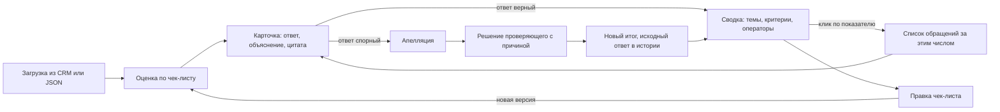

<a id="evaluation"></a>
## Как обращение превращается в оценку

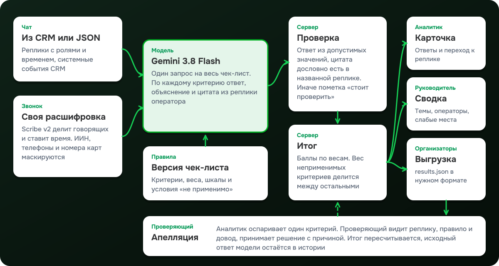

1. **Разговор.** Из CRM или JSON приходит текст с ролями, временем реплик и системными событиями. Именно этот исходный текст участвует в оценке. Для чтения и прослушивания звонка дополнительно готовится расшифровка Scribe v2: говорящие разделены, у слов есть время, личные данные заменены масками. Она не подменяет текст, по которому уже получена оценка.
2. **Правила.** Сервер фиксирует, какой текст разговора и какая версия чек-листа участвуют в оценке. Если по этому критерию уже есть совместимый ответ, он берётся из базы и модель не вызывается.
3. **Модель.** Gemini 3.8 Flash получает весь чек-лист одним запросом. На каждый критерий модель возвращает ответ из допустимых значений, объяснение на русском и цитату с номером реплики. Модель оценивает оператора; слова клиента, бота и системные события служат ей контекстом.
4. **Проверка.** Сервер убеждается, что ответ допустим для этого критерия и что цитата дословно стоит в названной реплике. Если проверка не прошла, результат этого критерия сохраняется как ошибка и доступен для повтора. Остальные корректные ответы остаются; полный итог появляется, когда готовы все критерии.
5. **Итог.** Баллы считает сервер по формуле ниже. Результат, модель, стоимость, время и версия правил сохраняются вместе с оценкой.

### Цитата сверяется с разговором

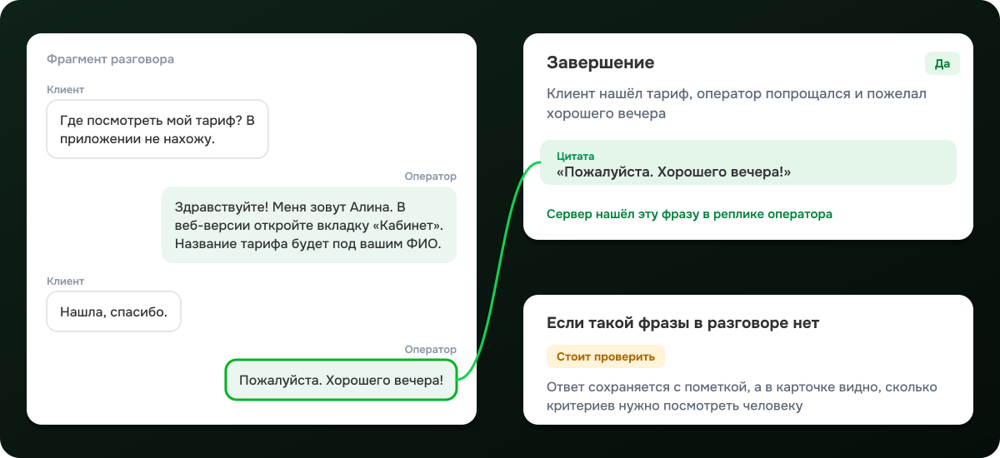

Клик по цитате переводит аналитика к реплике, у звонка также к соответствующему месту записи. Для отсутствующего действия модель указывает проверенный участок разговора и цитату из места, где действие ожидалось. Для неприменимого критерия сохраняются причина и подтверждающий фрагмент. В текущем режиме оценки цитата, которую не удалось найти, означает ошибку критерия; такой ответ не участвует в готовом итоге.

<a id="scoring"></a>
### Как считается итог

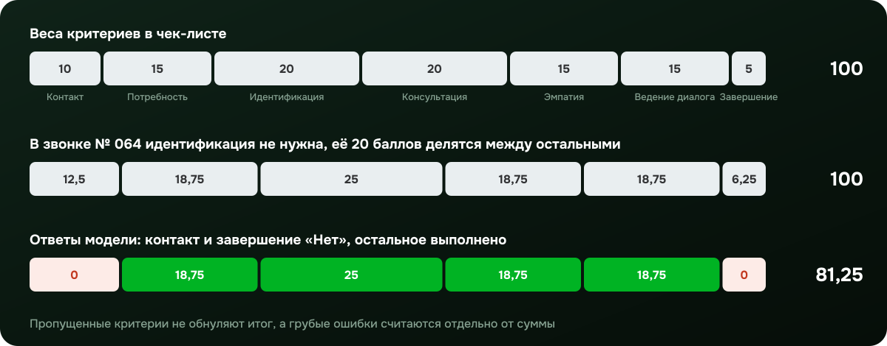

На схеме сохранённая оценка звонка № 064 из DEV-набора. В исходном чек-листе семь оцениваемых критериев с весами от 5 до 20 и отдельная отметка грубых ошибок. В этой оценке модель сочла консультацию по выходу из приложения и документам для регистрации не требующей идентификации: защищённые действия не выполнялись и данные счёта не раскрывались. Поэтому 20 баллов идентификации распределены между остальными критериями пропорционально их весу.

| Правило | Как работает |
| --- | --- |
| Бинарный критерий | «Да» даёт полный вес, «Нет» ноль |
| Шкала | Выбранная ступень делится на максимальную: «15 из 20» даёт 75 % веса |
| Не применимо | Критерий убирается из расчёта, его вес делится между остальными. Модель обязана назвать причину |
| Грубая ошибка | Отмечается отдельно с типом и цитатой и не смешивается с суммой |
| Незавершённая оценка | Если хотя бы один ответ не готов, итог не показывается как полный |
| Округление | Промежуточные доли не округляются, итог округляется до двух знаков |

```text
W           = сумма весов применимых критериев
доля i      = 100 × wᵢ / W
баллы i     = rᵢ × доля i,   где rᵢ = 1 для «Да», 0 для «Нет», ступень / максимум для шкалы
итог        = сумма баллов, округлённая до двух знаков
```

Для № 064: `W = 80`, у выявления потребности доля `100 × 15 / 80 = 18,75`, у консультации `25`. Набрано `18,75 + 25 + 18,75 + 18,75 = 81,25`.

<a id="registry"></a>
## Реестр обращений


Реестр открывается первым. Над списком видно, сколько обращений в базе, сколько оценено, средний итог и число грубых ошибок, и каждая из этих меток работает как быстрый фильтр. В строке номер, первый вопрос клиента, канал, язык, дата, длительность, итог и состояние апелляции. Наведение на итог раскладывает его по критериям.


| Инструмент | Что делает |
| --- | --- |
| Поиск | По номеру и тексту разговора |
| Фильтры | Язык, чат или звонок, состояние оценки, грубые ошибки, «стоит проверить», апелляции |
| Диапазоны | Итог от и до, даты от и до |
| Версия чек-листа | Итоги и выборка относятся к выбранной версии, результаты разных правил не смешиваются |
| Метки условий | Каждое применённое условие видно меткой; клик открывает его группу, крестик снимает |
| Пакетный выбор | Отдельные строки, диапазон через Shift, страница или все обращения по условиям |
| Пакетная обработка | Прогресс по настоящей задаче на сервере, готовые и ошибочные отдельно, повтор только ошибок |

Задача продолжает работать, если уйти на другой экран или перезагрузить страницу. Если исходный разговор изменился после оценки, прежний результат остаётся в истории с пометкой «устарела».

<a id="card"></a>
## Карточка разговора

Слева разговор, справа итог и критерии, сгруппированные по разделам чек-листа. Над разговором короткое резюме: о чём обращение, что хотел клиент и чем закончилось. В транскрипте сохранены роли клиента, оператора и бота, системные события CRM и паузы ожидания.

| Что видно | Зачем |
| --- | --- |
| Итог и полоса долей | Сразу понятно, какие критерии сколько принесли и где потери |
| Ответ, объяснение, цитата | Клик по цитате прокручивает разговор к реплике и подсвечивает её |
| «Не применимо» с причиной | Видно, почему критерий выпал и как распределился его вес |
| «Стоит проверить» | Сохранённая при оценке пометка для ручного разбора ответа |
| Ошибка критерия | Ответ не получен или не прошёл проверку; можно повторить этот критерий |
| История оценок | Прежняя оценка открывается с тем текстом и той версией правил, по которым она получена |
| Повтор одного критерия | Если один ответ не получился, остальные готовые ответы не теряются |
| Советы оператору и второе мнение | Отдельные ИИ-разборы по запросу аналитика |
| Стоимость и время | Сколько стоила и сколько шла эта оценка, в свёрнутом техническом блоке внизу |

<a id="calls"></a>
## Звонки

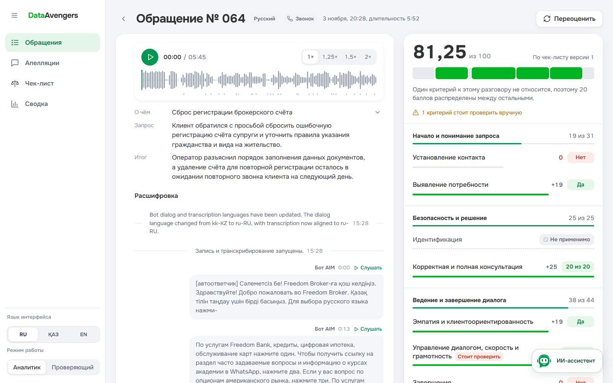

Расшифровка из CRM у звонков часто путает слова и языки, поэтому мы делаем свою. Запись скачивается через сервер, ElevenLabs Scribe v2 распознаёт речь, разделяет говорящих и проставляет время. Роли оператора, бота и клиента назначаются по содержанию реплик, а системные события CRM встают в общую ленту по времени.

Собственная расшифровка служит для чтения, перевода и навигации по записи. Оценка и резюме опираются на исходный текст из CRM или JSON; сохранённые ответы остаются связаны с ним. Это позволяет проверить источник прежней оценки даже при изменении отображаемого текста звонка.

| Возможность | Подробности |
| --- | --- |
| Плеер | Волна записи, скорость 1×, 1,25×, 1,5× и 2×, перемотка с клавиатуры |
| Связь с текстом | «Слушать» у реплики включает запись с нужного места; цитата в критерии ведёт туда же |
| Личные данные | ИИН, телефоны, номера карт, коды, личная почта и известные скрытые имена заменяются масками до сохранения |
| Сырые данные | Сырой ответ распознавания по умолчанию не хранится, временный аудиофайл удаляется |
| Стоимость | Пять звонков общей длиной около 35 минут расшифрованы за $0,128 |

<a id="translation"></a>
## Перевод разговора

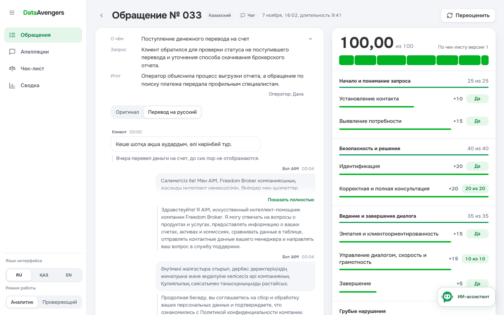

Аналитик, который не читает по-казахски, всё равно может проверить казахский разговор. Переключатель «Оригинал / Перевод» показывает перевод под каждой репликой, а оригинал остаётся рядом. Цитаты модели тоже доступны в переводе. Переводятся реплики на русский, казахский и английский; язык перевода следует за языком интерфейса. Маски личных данных при переводе не трогаются, сервер это проверяет. Оценка всегда идёт по исходному тексту.

<a id="assistant"></a>
## ИИ-ассистент

Ассистент доступен из разных разделов и работает со **всей базой обращений**. В сводке его открывает кнопка «Спросить ассистента», на остальных экранах есть кнопка в правом нижнем углу. Открытая карточка и выбранные фильтры подсказывают ему, что значит «это обращение» или «эти результаты».

Чтобы ответить, ассистент сам вызывает инструменты чтения: серверную сводку, поиск разговоров, чтение конкретного разговора, распределение тем, сравнение версий чек-листа. Пока он работает, видно, что именно он делает: ищет обращения, читает разговор, сравнивает правила. Текст появляется по мере генерации.

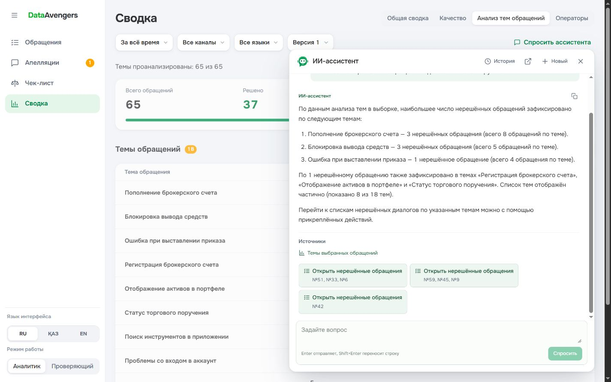

В конце ответа стоят источники и кнопки перехода: открыть обращение, открыть группу обращений по критерию в реестре, открыть сравнение версий. Сервер проверяет, что упомянутые обращения существуют, а цитаты дословно есть в разговорах.

| Тема | Пример вопроса |
| --- | --- |
| Разбор оценки | «Почему здесь сняли баллы за консультацию? Покажи реплики» |
| Поиск | «Найди разговоры о выводе средств с итогом ниже 70» |
| Качество | «Какие критерии чаще всего не выполняются? Покажи пару примеров» |
| Темы | «Какие вопросы чаще остаются нерешёнными?» |
| Операторы | «Что улучшить этому оператору? Предложи формулировку» |
| Чек-лист | «Чем отличаются версии 1 и 2? Понадобится ли новая оценка?» |

Ассистент только читает данные: он не меняет оценки, не решает апелляции и не запускает обработку. Общие числа он берёт из сводки, а не из нескольких найденных примеров. Беседы сохраняются в браузере, к любой можно вернуться через «Историю диалогов»; новый чат не стирает старый.

У каждого чата свой черновик. Выбранная беседа продолжается при переходах между экранами и рабочими режимами. История остаётся после перезагрузки на этом браузере и не синхронизируется между устройствами. Сохраняются до 30 чатов и 60 пар «вопрос — ответ» в каждом; для следующего ответа модель получает последние 12 сообщений. При заполнении хранилища появляется сообщение, старые беседы автоматически не удаляются.

Запрос можно остановить. Незавершённый ответ не становится сохранённым, а вопрос остаётся в черновике. При обновлении связанных данных ассистент перепроверяет использованные источники; изменение несвязанной темы не прерывает разговор о выбранной оценке.

Точное совпадение цитаты подтверждает её источник, но не правильность каждого вывода модели. Предложенные фразы и советы остаются материалом для проверки человеком; отдельного справочника внутренних правил брокера у ассистента нет.

Сводные числа доступны по всей выбранной базе; подробное чтение за один ответ ограничено пятью разговорами и 45 000 символами текста. На ответ выделено до трёх вызовов модели и 240 секунд. Для широкого вопроса ассистент выбирает примеры или предлагает сузить выборку.

<a id="insights"></a>
## Сводка

Сводка отвечает руководителю на вопрос «где у нас проблемы» и от каждого числа ведёт к разговорам, из которых оно получилось. Наверху общий фильтр по периоду, каналу, языку и версии чек-листа; он действует на все вкладки.

<table>
  <tr>
    <td width="50%">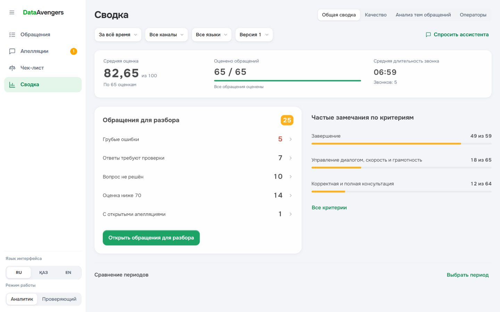</td>
    <td width="50%">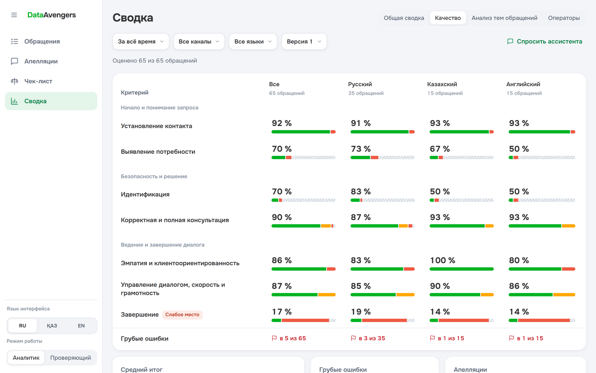</td>
  </tr>
  <tr>
    <td><b>Общая сводка.</b> Сколько оценено, средний итог, средняя длительность звонка, апелляции на рассмотрении и поводы для разбора: итог ниже 70, грубые ошибки, ответы «стоит проверить», нерешённые вопросы.</td>
    <td><b>Качество.</b> Доля выполнения каждого критерия всего и отдельно по RU, KZ и EN, распределение ответов и неприменимость. Слабое место подсвечено: на DEV это завершение разговора, около 17 %.</td>
  </tr>
  <tr>
    <td></td>
    <td>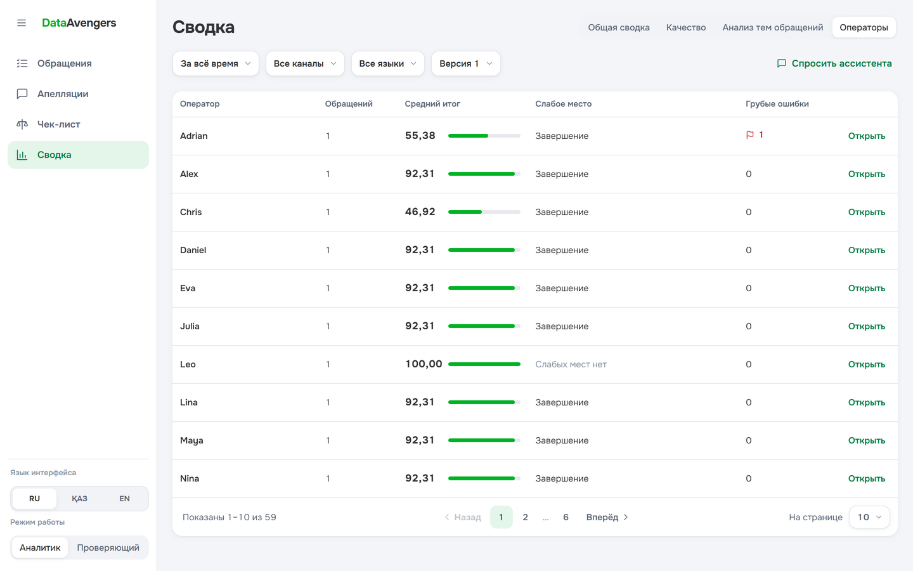</td>
  </tr>
  <tr>
    <td><b>Темы обращений.</b> Модель относит каждое обращение к теме и отмечает исход: решено, не решено или неизвестно. Видно, с чем приходят чаще всего и где клиент уходит без решения, например «Блокировка вывода средств»: 0 решённых из 5.</td>
    <td><b>Операторы.</b> Средний итог, слабый критерий и грубые ошибки по каждому оператору. Клик открывает профиль с его критериями и списком разговоров.</td>
  </tr>
</table>

Сравнение периодов показывает изменение итога относительно предыдущего периода той же длины, если готовых оценок по одной версии чек-листа достаточно. Неизвестный исход темы не засчитывается как решённый, а незавершённые и устаревшие оценки не попадают в средний балл.

На вкладке тем сначала видны исходы всей выбранной группы: сколько вопросов решено, осталось без решения и не имеет известного результата. Ниже таблица по десять тем на странице: объём, исходы и средняя оценка. По умолчанию выше стоят темы с большим числом нерешённых вопросов; порядок можно поменять на количество обращений или название. Отдельная кнопка оставляет редкие темы. Название темы открывает все её обращения, а число в колонке исхода только соответствующую группу. Обращения без определённой темы доступны отдельной ссылкой.

<a id="checklists"></a>
## Чек-лист и его версии


Чек-лист открывается как документ: разделы, правило каждого критерия, тип ответа, вес и доля в итоге, условие «не применимо». Редактор позволяет начать с шаблона или с нуля, заменить критерий на новый с сохранением места и веса, отменить удаление и посмотреть сводку изменений перед сохранением. Каждое сохранение становится новой версией, и у каждой оценки видно, по какой версии она сделана.

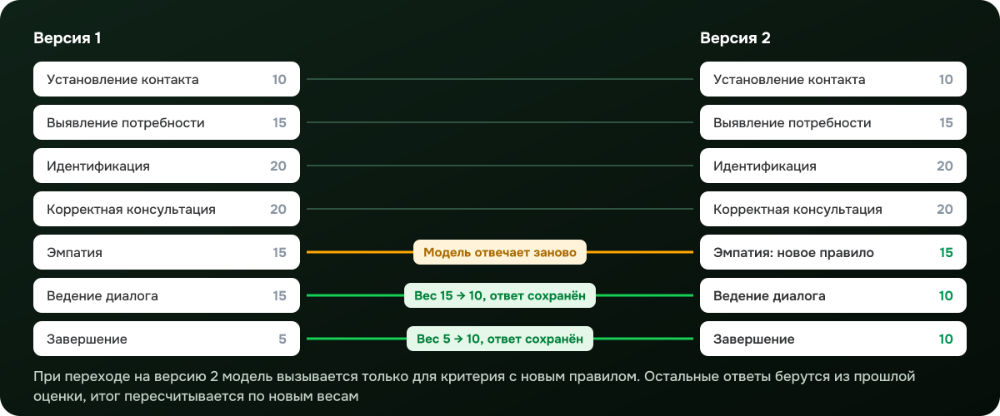


Сравнение двух версий показывает «Было» и «Стало» по каждому изменению: названия, правила, шкалы, типы нарушений, условия неприменимости, веса, разделы и порядок. Просмотр сравнения ничего не запускает. Применение версии идёт отдельным шагом: сначала выбираются обращения, затем запускается задача, а таблица результатов показывает, как изменился итог каждого.

| Что изменилось в критерии | Что происходит с оценкой |
| --- | --- |
| Только вес | При наличии совместимого ответа итог пересчитывается без новой оценки модели |
| Раздел или порядок | Содержание критерия сохраняется; готовый совместимый ответ используется повторно |
| Название, правило, шкала или условие неприменимости | Модель отвечает заново на новое правило |
| Новый критерий | Модель отвечает только на него |
| Удалённый критерий | Не участвует в версии и её итоге |

После замены одного критерия остальные готовые ответы можно использовать повторно, если совпадают исходный разговор, содержание правила и совместимые настройки модели. При отсутствии подходящего сохранённого ответа нужна новая оценка и для неизменённого критерия. Решения проверяющих по апелляциям на новую версию автоматически не переносятся: их принимали по прежним правилам.

<a id="appeals"></a>
## Апелляции


Аналитик оспаривает конкретный критерий и пишет, с чем не согласен. Проверяющий видит очередь открытых апелляций с номером обращения, критерием, языком, каналом и временем ожидания. Внутри апелляции рядом лежат фрагмент разговора с процитированной репликой, правило критерия, ответ модели и довод аналитика. Можно запросить у модели второе мнение, а новый итог виден ещё до сохранения.

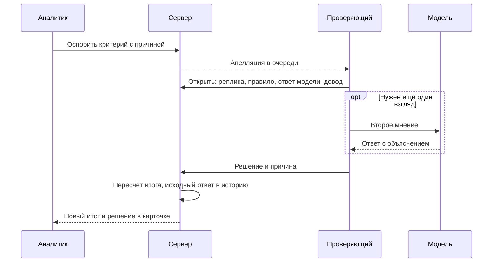

После решения в карточке видны исходный ответ модели, ответ проверяющего, причина и новый итог. Сводка учитывает исправленный результат. CSV и JSON через API содержат исходные и окончательные ответы отдельно; `results.json` для организаторов сохраняет исходные ответы модели.

<a id="import"></a>
## Импорт, автоматическая обработка и выгрузка

| Возможность | Подробности |
| --- | --- |
| JSON | Файл или перетаскивание, проверка формата и предпросмотр до загрузки. Поддерживаются массив записей, `{ "records": [...] }` и `{ "data": { "records": [...] } }` |
| CRM | Синхронизация выбранного набора с постоянными номерами обращений |
| Без дублей | Новые записи добавляются, изменённые обновляются, неизменные пропускаются. Импорт сообщает, сколько каких |
| Автообработка | Новые обращения сразу встают в очередь на оценку, резюме и расшифровку звонков; каждое действие отключается отдельно |
| Выгрузка | `results.json` в формате организаторов из интерфейса, а также CSV и JSON через API |
| Учёт расходов | Стоимость каждой оценки, перевода, расшифровки и ответа ассистента. Если провайдер не вернул цену, сумма помечается неполной, а не обнуляется |

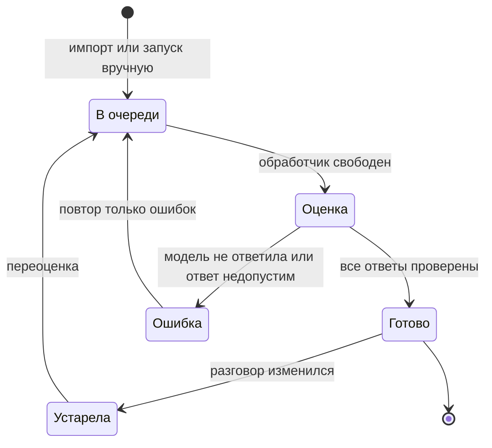

<a id="languages"></a>
## Три языка интерфейса

Интерфейс полностью переведён на русский, казахский и английский. Язык меняется на лету: открытые формы, черновики, запущенные задачи и воспроизведение записи сохраняются. Правила чек-листа, написанные автором, и системные события CRM остаются в исходном виде. Объяснения модели пишутся по-русски, цитаты остаются на языке разговора.

<a id="quality"></a>
## Совпадение с разметкой команды

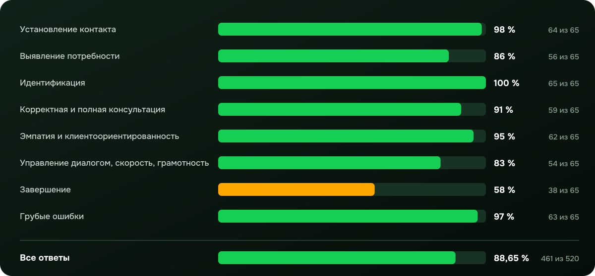

Официального эталона на DEV-наборе у нас не было, поэтому мы разметили все 65 обращений сами: по одному ответу на каждую пару «обращение и критерий», всего 520 ответов по исходному чек-листу. Это наше понимание критериев, и процент выше показывает согласие модели с ним, а не точность относительно организаторов. На этих же обращениях мы настраивали промпт, так что на новых данных результат может отличаться.

| Показатель прогона | Результат |
| --- | ---: |
| Совпадение ответов с разметкой команды | 461 из 520, 88,65 % |
| Обращения, где совпали все восемь ответов | 25 из 65 |
| Средняя разница итога с итогом по разметке | 7,54 балла из 100 |
| Допустимые ответы модели | 520 из 520 |
| Объяснения, прошедшие проверку формата и цитат | 515 из 520 |
| Запросы к модели | 65, без повторов |
| Стоимость прогона | $0,6427 |
| Медиана и P95 времени на обращение | 8,0 и 10,4 секунды |

Сильнее всего мы расходимся с моделью на завершении разговора: 27 расхождений из 65. Затем идут управление диалогом, 11 расхождений, и выявление потребности, 9. Расхождение само по себе не говорит, кто прав, поэтому такие случаи мы разбираем в карточке по цитатам и уточняем либо правило в чек-листе, либо свою разметку.

Выборка: 35 обращений на русском, 15 на казахском и 15 на английском, 60 чатов и 5 звонков. Ответ засчитывается только при точном совпадении; у шкалы сравнивается ступень, «не применимо» считается отдельным значением. Бутстрэп по обращениям даёт интервал совпадения от 85,6 % до 91,5 %. Модель `google/gemini-3.8-flash` через OpenRouter, температура 0, все критерии в одном запросе, прогон 7 ноября 2026 года. Методика и прежние замеры: [docs/accuracy.md](docs/accuracy.md). Внутренний экран `#/lab/accuracy` сравнивает ответы модели с любой загруженной CSV-разметкой.

<a id="architecture"></a>
## Архитектура

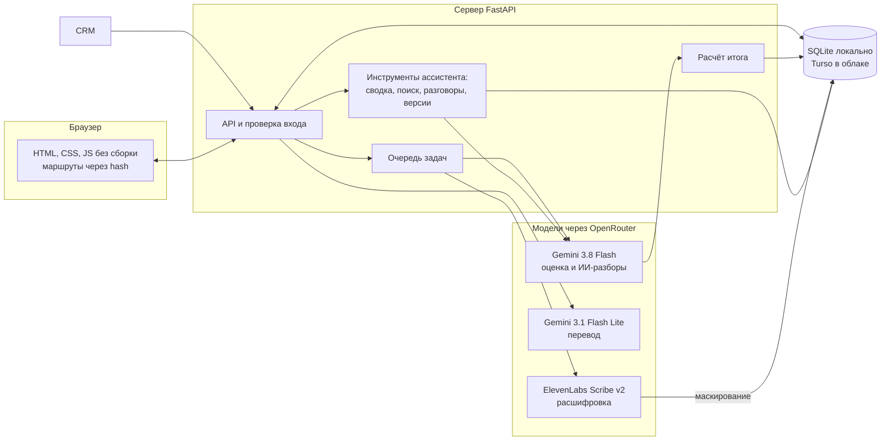

| Слой | Реализация | Почему так |
| --- | --- | --- |
| Интерфейс | HTML, CSS и JavaScript без сборки, маршруты через hash | Экраны открываются по прямой ссылке и встраиваются веб-ресурсом в Dynamics 365 |
| API | Python 3.10+, FastAPI, Pydantic | Проверка входных данных, одна формула итога для всех экранов |
| Хранение | SQLite локально, libSQL / Turso в облаке | Обращения, версии чек-листа, оценки, задачи и история решений |
| Фоновая обработка | Один обработчик с сохранённым состоянием задач | Оценка и расшифровка идут независимо от открытого экрана и переживают перезапуск |
| Оценка и ИИ-разборы | Gemini 3.8 Flash через OpenRouter | Строгий JSON-ответ, один запрос на весь чек-лист |
| Перевод | Gemini 3.1 Flash Lite через OpenRouter | Дешёвый перевод с проверкой сохранности масок |
| Расшифровка | ElevenLabs Scribe v2 через OpenRouter | Говорящие и время слов |
| Размещение | Vercel: CDN, Python API и отдельный Daemon для очереди | Статика отдельно от API, очередь работает постоянно |

Ключи моделей хранятся только в переменных сервера и в браузер не попадают. Сервер проверяет источник изменяющих запросов и скачивает записи звонков только с разрешённых адресов.

<a id="local-run"></a>
## Запуск у себя

Нужны Python 3.10+ и Git. Node.js для работы приложения не нужен. Если в `PATH` есть `ffmpeg` и `ffprobe`, сервер дополнительно проверяет полноту скачанной записи звонка.

### 1. Установить зависимости

Windows, PowerShell:

```powershell
git clone https://github.com/zzhassyn/data-freedom.git
cd data-freedom\backend
python -m venv .venv
.\.venv\Scripts\python.exe -m pip install -r requirements.txt
if (-not (Test-Path .env)) { Copy-Item .env.example .env }
```

Linux и macOS:

```bash
git clone https://github.com/zzhassyn/data-freedom.git
cd data-freedom/backend
python3 -m venv .venv
./.venv/bin/python -m pip install -r requirements.txt
if [ ! -f .env ]; then cp .env.example .env; fi
```

Активировать окружение не нужно: команды обращаются к его Python напрямую.

### 2. Подключить модель

В `backend/.env`:

```dotenv
JUDGE=openrouter
JUDGE_MODEL=google/gemini-3.8-flash
OPENROUTER_API_KEY=ваш_ключ
```

Без ключа работают реестр, импорт, чек-листы и просмотр сохранённых данных. Чтобы сначала загрузить данные без автоматической оценки, резюме и расшифровки, добавьте:

```dotenv
AUTO_EVALUATE_IMPORTS=false
AUTO_SUMMARIZE=0
STT_ENABLED=false
```

| Переменная | По умолчанию и назначение |
| --- | --- |
| `DB_PATH` | `./data/cqa.sqlite`; путь от каталога `backend` или абсолютный |
| `AI_MODEL` | Модель ИИ-разборов и ассистента; если пусто, берётся `JUDGE_MODEL` |
| `JUDGE_CONCURRENCY` | `8`, общий предел одновременных запросов к модели |
| `JUDGE_MAX_TOKENS` | `8192`, предел токенов на запрос оценки |
| `MODEL_TIMEOUT_SECONDS` | `180`, срок ответа модели |
| `TRANSLATION_MODEL` | `google/gemini-3.1-flash-lite` |
| `STT_MODEL` | `elevenlabs/scribe-v2` |
| `STT_KEEP_RAW` | `false`, сырые ответы распознавания не сохраняются |
| `ORG_API_URL` | Адрес CRM для синхронизации |
| `AUDIO_ALLOWED_HOSTS` | Разрешённые хосты записей через запятую |

Изменения `.env` применяются после перезапуска. Остальные настройки и контракт API описаны в [backend/README.md](backend/README.md).

### 3. Запустить

Из каталога `backend`:

```powershell
.\.venv\Scripts\python.exe -m uvicorn app.main:app --port 8000
```

```bash
./.venv/bin/python -m uvicorn app.main:app --port 8000
```

Приложение откроется на [localhost:8000](http://localhost:8000/), описание API на [localhost:8000/docs](http://localhost:8000/docs). При первом запуске создаются пустая база и исходный чек-лист. Запускайте один процесс, без нескольких `--workers`: очередь задач рассчитана на один обработчик.

### 4. Загрузить обращения

Нажмите «Загрузить обращения» и выберите JSON-файл или вкладку «Из CRM». После загрузки выберите обращения в реестре и запустите оценку, если автоматическая оценка выключена.

<a id="self-deploy"></a>
## Развернуть свою версию

Облачная установка состоит из одного проекта Vercel, базы Turso и одного Vercel Daemon. Интерфейс раздаёт CDN, FastAPI обслуживает API, Daemon выполняет очередь. Так же устроена [наша установка](https://data-freedom.vercel.app).

### 1. Проект и база

Корнем проекта Vercel должен быть корень репозитория с `vercel.json` и `index.py`, а не каталог `backend`.

```bash
npm install --global vercel
vercel login
vercel link
```

Подключите базу через [интеграцию Turso для Vercel](https://vercel.com/marketplace/tursocloud/database). Она добавит `TURSO_DATABASE_URL` и `TURSO_AUTH_TOKEN`. Если база создана отдельно:

```bash
vercel env add TURSO_DATABASE_URL --environment production
vercel env add TURSO_AUTH_TOKEN --environment production --sensitive
```

### 2. Переменные сервера

```bash
vercel env add OPENROUTER_API_KEY --environment production --sensitive
vercel env add JUDGE --environment production
vercel env add JUDGE_MODEL --environment production
```

В ответ на запросы введите ключ, `openrouter` и `google/gemini-3.8-flash`. `WORKER_MODE` задавать не нужно: `index.py` сам запускает режим API, а `backend/Dockerfile.worker` режим обработчика.

### 3. Публикация

```bash
python scripts/deploy.py --dry --json
python scripts/deploy.py --prod
vercel daemons list
```

`deploy.py` сначала копирует актуальные HTML, JS, CSS и SVG в `public/` через `scripts/build_static.py`, затем вызывает Vercel CLI. В предварительном списке файлов не должно быть `.env`, `.sqlite`, `.venv` и личных выгрузок. Локальная база в облако не переносится, обращения загружаются через приложение.

### 4. Проверка

| Что проверить | Ожидаемый результат |
| --- | --- |
| Адрес приложения | Открываются страница, стили и скрипты |
| `/api/health` | Имя модели, доступ к OpenRouter по ключу, учтённые расходы |
| `/api/bootstrap` | Обращения и чек-листы, ответ не кешируется |
| `vercel daemons list` | Один обработчик в регионе `iad1` |
| Небольшой импорт | Записи видны после перезагрузки |

Обработчику выделен 1 GiB памяти. Daemon работает только в production. На тарифе Hobby месячной квоты хватает примерно на 17 суток постоянной работы одного обработчика, поэтому для круглосуточной работы нужен платный план, а в остальное время обработчик можно останавливать:

```bash
vercel daemons scale worker iad1=0
vercel daemons scale worker iad1=1
```

Пока обработчик остановлен, задачи ждут в очереди. Vercel принимает запросы до 4,5 МБ, поэтому большой JSON для облачной установки лучше разбить на несколько файлов; локально импорт принимает до 20 МБ. Подробности размещения: [docs/deployment.md](docs/deployment.md).

<a id="own-server"></a>
### Свой сервер вместо Vercel

1. Установите Python и зависимости, настройте `.env` и ключ модели.
2. Положите базу на постоянный диск, например `DB_PATH=/var/lib/dataavengers/cqa.sqlite`.
3. Оставьте `TURSO_DATABASE_URL` и `TURSO_AUTH_TOKEN` пустыми и задайте `WORKER_MODE=standalone`.
4. Запускайте один процесс через systemd или другой менеджер процессов с перезапуском при сбое.
5. Поставьте перед приложением обратный прокси с HTTPS.

```bash
./.venv/bin/python -m uvicorn app.main:app --host 127.0.0.1 --port 8000
```

Для резервной копии остановите процесс и скопируйте каталог базы целиком вместе со служебными файлами WAL.

<a id="verification"></a>
## Тесты и устройство репозитория

Серверные тесты покрывают расчёт итога, импорт, версии чек-листа, очередь, апелляции, работу с моделями, перевод, расшифровку, аналитику и ассистента. Тесты интерфейса на `node:test` проверяют фильтры реестра, сравнение версий, сводку, очередь апелляций, ассистента и работу с API. Сценарии проверки интерфейса описаны в [web/TESTING.md](web/TESTING.md).

```bash
cd backend
./.venv/bin/python -m pytest -q            # Windows: .\.venv\Scripts\python.exe -m pytest -q
cd ..
node --test web/tests/*.test.cjs
```

| Путь | Что там |
| --- | --- |
| [`web/`](web/README.md) | Экраны, стили, локализация, работа с API, ассистент |
| [`backend/app/`](backend/README.md) | API, хранение, импорт, оценка, апелляции, аналитика, очередь |
| [`backend/app/judge/batch_prompts/`](backend/app/judge/batch_prompts/system.md) | Промпт оценки всего чек-листа одним запросом |
| [`backend/app/seed/checklist_v1.json`](backend/app/seed/checklist_v1.json) | Исходный чек-лист |
| [`scripts/`](scripts/deploy.py) | Сборка статики и публикация в Vercel |
| [`docs/accuracy.md`](docs/accuracy.md) | Методика сравнения с разметкой и прежние замеры |
| [`docs/deployment.md`](docs/deployment.md) | Облачное размещение, обработчик, база |
| [`results/dev/results.json`](results/dev/results.json) | Выгрузка DEV-прогона в формате организаторов |

<p align="center"></p>
<p align="center">Команда DataAvengers · хакатон Freedom Broker</p>
