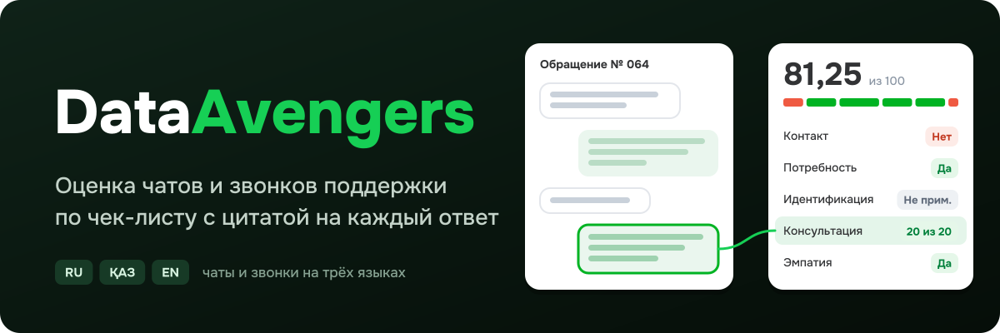
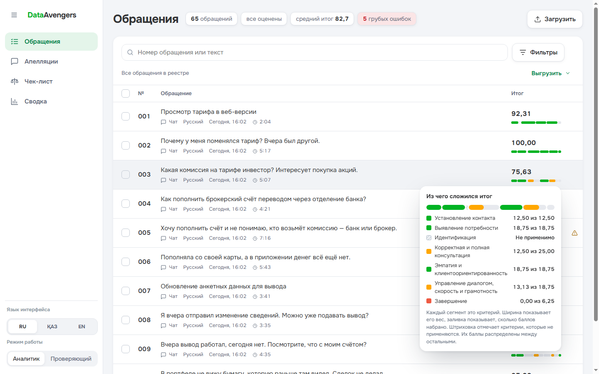
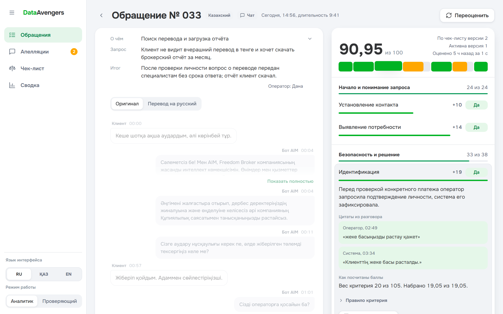
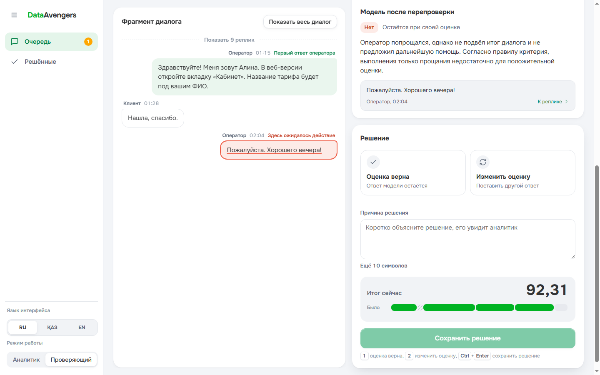
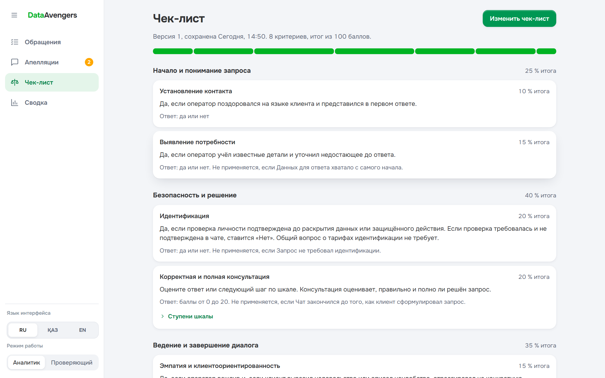
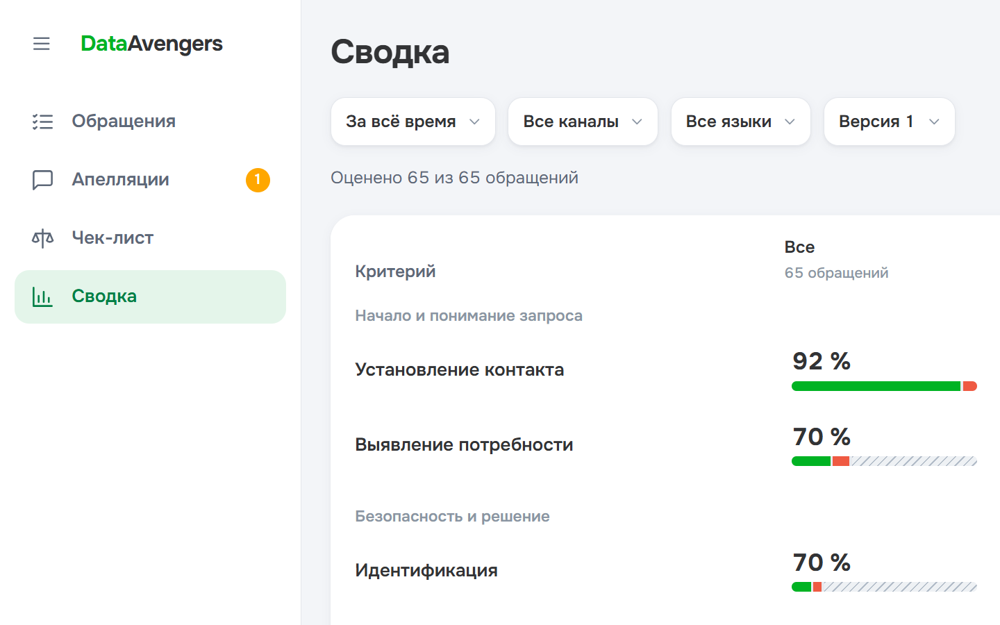
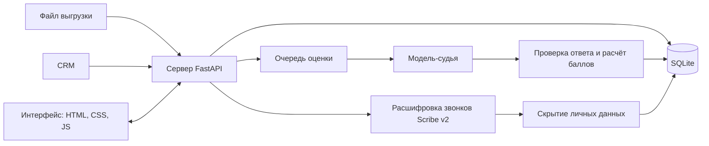

DataAvengers проверяет чаты и звонки поддержки Freedom Broker по чек-листу качества. Модель отвечает по каждому критерию, объясняет ответ и приводит цитаты из разговора. Сервер сам считает баллы. Аналитик может оспорить оценку, проверяющий решает спор, итог пересчитывается, а исходная оценка сохраняется в истории.

## Как это выглядит

**Реестр обращений.** Номер, дата, язык, канал и короткая тема разговора. При наведении на итог видно, из чего он сложился.



**Карточка обращения.** Слева разговор, справа оценка. Наведение на критерий подсвечивает реплики, на которых основан ответ. Клик по цитате прокручивает к нужному сообщению, у звонка перематывает запись.



**Рабочее место проверяющего.** Очередь споров сверху, фрагмент разговора слева, правило критерия, ответ модели, довод аналитика и решение справа. Новый итог виден до сохранения.



**Чек-лист.** Открывается как документ: правила, доля каждого критерия в итоге, история версий. Редактор ведёт по шагам и показывает изменения перед сохранением.



**Сводка.** Выполнение критериев по языкам и рейтинг операторов.



## Что умеет

| Задача | Как сделано |
| --- | --- |
| Настройка чек-листа | Добавление, удаление и правка критериев, тип ответа (да или нет, шкала, отметка нарушения), вес, условие «не применяется». Каждое сохранение создаёт новую версию. |
| Оценка диалога | Gemini получает нужные критерии одним запросом и возвращает отдельный ответ по каждому. Сервер проверяет допустимые значения, точные цитаты и диапазоны доказательств. |
| Результат | Ответ, баллы, вес, объяснение и реплика-доказательство по каждому критерию. Для пропущенного действия отмечен участок, где его ждали. Для «не применимо» указана причина. |
| Вес и итог | Баллы считает сервер. Вес неприменимых критериев делится между остальными пропорционально. Итог округляется до двух знаков половиной вверх. Грубая ошибка отмечается отдельно и не обнуляет итог. |
| Карточка | Переход от цитаты к сообщению, свой плеер звонка с перемоткой к реплике. |
| Апелляция и решение | Аналитик оспаривает критерий с комментарием, проверяющий подтверждает или меняет ответ с причиной. Видны исходная оценка, решение и финальный итог. |
| Замена критерия | «Заменить» открывает шаблоны и создание с нуля. Новый критерий занимает прежнее место и сохраняет вес. После сохранения версии заново оцениваются изменённые критерии; таблица «Было и стало» показывает разницу. |

Также доступны:

- лента весов: итог виден полосой из критериев, перераспределение веса понятно без слов;
- пакетная оценка с живым прогрессом по строкам;
- отдельный повтор ошибочного критерия с сохранением уже готовых ответов; прежние отметки «стоит проверить» сохраняются в истории;
- синхронизация обращений из CRM без дублей и загрузка выгрузки файлом;
- расшифровка звонков с разделением говорящих и таймкодами;
- скрытие личных данных в расшифровке: ИИН, телефоны, карты, коды, адреса, имена;
- резюме разговора, перевод реплик на русский, казахский и английский, советы оператору;
- интерфейс на трёх языках;
- выгрузка результатов в CSV и JSON.

## Как оцениваем

- Проверяется работа оператора. Клиент, бот AIM и системные события дают контекст. Объяснения написаны по-русски, цитаты сохраняют язык разговора.
- Проверка личности учитывается до раскрытия данных счёта или защищённого действия. Подходит системное подтверждение на любом из трёх языков либо сверка ФИО и ещё одного идентификатора с подтверждённым совпадением. Для общих вопросов и навигации идентификация не требуется.
- Скрытое имя в представлении оператора считается представлением. Если системное событие подтверждает, что запись звонка началась после соединения, а приветствие не попало в первую реплику оператора, исходный критерий контакта может быть неприменим.
- Базы знаний Freedom у модели нет. Она проверяет логику, полноту ответа и следующий шаг по самому разговору. Непроверяемые факты и нехватка данных отмечаются для проверки человеком.
- Новые и изменённые критерии оцениваются по их текущему правилу. Сначала проверяется применимость, затем условия и ступень шкалы. Если модель не смогла обосновать ответ или цитата не прошла проверку, критерий требует повтора и готовый полный итог не выдаётся. Решение по апелляции принимает человек.

## Как устроено



- **Интерфейс**: обычные HTML, CSS и JavaScript без сборки и библиотек. Каждый экран открывается по своему адресу, поэтому его можно встроить веб-ресурсом Dynamics 365. Подробно в [web/README.md](web/README.md).
- **Сервер**: Python, FastAPI, SQLite. Очередь оценок с частичными результатами, повтор упавшего критерия, переиспользование ответов при новой версии чек-листа. Подробно в [backend/README.md](backend/README.md).
- **Модели** через OpenRouter: оценка, резюме, советы и помощь с правилами используют `google/gemini-3.8-flash`. Для оценки выбран структурный ответ с последующей проверкой цитат сервером. Расшифровка звонков использует `elevenlabs/scribe-v2`, перевод использует `google/gemini-3.1-flash-lite`. Резюме и советы появляются по мере получения текста.

## Запуск

Для размещения на Vercel используйте `python scripts/deploy.py --prod`: команда готовит браузерные файлы для CDN и запускает Vercel CLI. Настройка сервера, базы и фонового worker описана в [инструкции по деплою](docs/deployment.md).

Нужен Python 3.10 или новее. Для проверки полноты записей звонков желательны `ffmpeg` и `ffprobe` в `PATH`.

```powershell
git clone https://github.com/zzhassyn/data-freedom.git
cd data-freedom\backend
python -m venv .venv
.\.venv\Scripts\python.exe -m pip install -r requirements.txt
if (-not (Test-Path .env)) { Copy-Item .env.example .env }
```

CRM, загрузка файлов, реестр, чек-листы и сохранённые данные работают локально без ключа OpenRouter. Для оценки, резюме, советов, расшифровки и перевода добавьте ключ в `backend/.env`; в примере уже выбраны `JUDGE=openrouter` и модель оценки:

```dotenv
OPENROUTER_API_KEY=ваш_ключ
```

Запустите сервер:

```powershell
.\.venv\Scripts\python.exe -m uvicorn app.main:app --port 8000
```

Откройте [localhost:8000](http://localhost:8000/). Интерфейс, сервер и SQLite работают на этом компьютере; база и начальный чек-лист создаются сами. Обращения загружаются кнопкой «Загрузить»: файлом JSON или вкладкой «Из CRM». С ключом OpenRouter новые обращения сразу поступают на оценку; для уже загруженных можно выбрать повторную обработку. Без ключа диалоги сохраняются, а интерфейс объясняет, почему ИИ-обработка недоступна.

## Стоимость

| Операция | Модель | Цена |
| --- | --- | --- |
| Оценка, резюме и советы | `google/gemini-3.8-flash` | учтённый расход по данным OpenRouter |
| Расшифровка звонка | `elevenlabs/scribe-v2` | около 2,5 цента за звонок в проверенной выборке, $0,22 за час записи |
| Перевод разговора | `google/gemini-3.1-flash-lite` | учтённый расход по данным OpenRouter |

Сохранённые 65 обращений DEV оценены прежним покритериальным режимом. За 759 вызовов, включая дополнительные проверки и повторы, учтено **$4,6234 по данным провайдера**. Строгая выгрузка содержит 65 успешных результатов; переход на новый режим эти оценки не пересчитывает.

В прежнем режиме одна полная оценка в проверенном примере заняла **14,2 с**, с учтённым расходом **$0,0524** за 12 вызовов модели. От запуска отдельной партии из 10 чатов до готовности всех оценок прошло **120,037 с**. Это исторические замеры; подробности — в [отчёте](docs/accuracy.md).

Новый режим использует один запрос Gemini для всех требующих оценки критериев разговора, без второго модельного проверяющего. Общий расход учитывается один раз. Если провайдер не вернул сведения о стоимости, карточка показывает известную сумму и отмечает неполные данные. Совместимые ответы можно переиспользовать при изменении только веса; ответы прежнего семантического режима остаются в истории, но не выдаются за новые.

Пять звонков расшифрованы за $0,128. Распознавание, переводы и остальные ИИ-функции оплачиваются отдельно от оценки.

## Личные данные

При расшифровке запись звонка уходит через OpenRouter в ElevenLabs. Сервер скрывает в тексте ИИН, телефоны, карты, личную почту, коды из СМС, адреса и имена, уже скрытые в исходных данных. По умолчанию сырые ответы не сохраняются, временный аудиофайл удаляется. Оценка идёт по исходному транскрипту обращения.

Сервер проверяет источник изменяющих запросов, а записи звонков скачивает только с разрешённых адресов. Подробные настройки описаны в [документации сервера](backend/README.md).

## Проверки

Совпадение с независимой ручной разметкой ещё не измерено: эталон готовится. Методика и текущий статус описаны в [отчёте о точности](docs/accuracy.md).

```powershell
cd backend
.\.venv\Scripts\python.exe -m pytest -q
```

Функциональные и визуальные проверки интерфейса описаны в [web/TESTING.md](web/TESTING.md).
