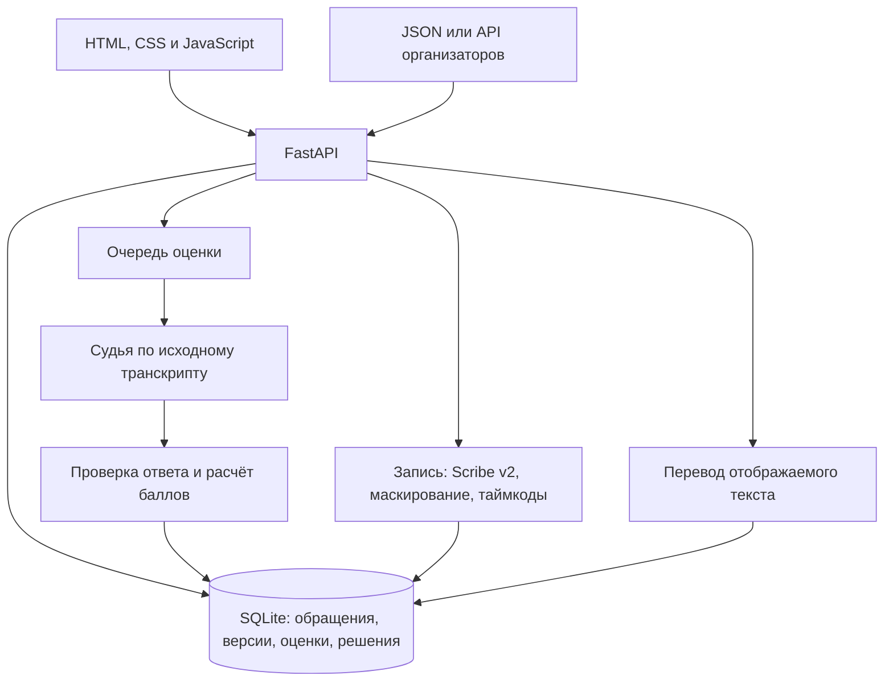

# DataAvengers

DataAvengers помогает аналитикам качества Freedom Broker разбирать чаты и звонки поддержки. Аналитик загружает обращения, получает оценку по чек-листу с объяснениями и цитатами, а спорный критерий передаёт проверяющему. Решение проверяющего пересчитывает итог и сохраняется вместе с исходной оценкой. Изменение чек-листа создаёт отдельную версию, результаты которой можно сравнить с предыдущей.

В текущей версии судья использует подготовленные ответы для **5 из 65 обращений DEV**. Реальная модель оценки ещё не подключена. Распознавание звонков и перевод на русский, казахский и английский работают через OpenRouter при наличии ключа. Резюме, советы оператору и повторное мнение пока также используют подготовленные примеры.

[Запуск](#запуск) | [Модели и стоимость](#модели-и-стоимость) | [Защита данных](#данные-и-конфиденциальность) | [Показ за пять минут](docs/demo.md)

## От обращения к проверенному решению

В карточке [№001](http://localhost:8000/#/c/p1-ru-001) клиент нашёл тариф, а оператор попрощался. Подготовленная оценка считает завершение неполным: в объяснении есть цитата и проверенный участок. Аналитик может оспорить этот ответ. Проверяющий видит тот же разговор, комментарий и возможный итог до сохранения решения. Исходный ответ остаётся в истории.


Остальные действия продолжают работу с теми же данными:

- Реестр позволяет искать обращения, выбирать набор и запускать оценку пакетом. Новые обращения после импорта автоматически поступают в очередь; ошибки можно отфильтровать и повторить отдельно.
- В карточке видны результаты критериев, причины «Не применимо», перераспределение баллов и ссылки на доказательства. У звонка запись воспроизводится внутри карточки; прослушивание можно начать с реплики.
- Для звонка показывается готовая очищенная расшифровка с таймкодами и системными событиями CRM. Пока её нет, доступен исходный текст организаторов. Оценка всегда привязана к исходному транскрипту, а цитаты сопоставляются с отображаемыми репликами.
- Язык интерфейса выбирается в боковом меню. Перевод следует за выбранным языком, если пользователь включил его; оригиналы сохраняются. Переключение языка сохраняет открытую карточку, черновики и состояние аудио.
- Проверяющий подтверждает ответ или меняет его с обязательной причиной. Результат пересчитывается на сервере.
- Редактор сохраняет версии чек-листа. Изменение только весов использует прежние ответы без новых вызовов судьи; изменение правила требует новой оценки. Таблица «Было и стало» показывает результат применения версии.

## Запуск

Нужны Python 3.10 или новее и современный браузер. Для проверки полноты записей установите `ffmpeg` и `ffprobe` в `PATH`. Без них распознавание возможно, но приложение не подтверждает полноту декодированного аудио. Интерфейс не требует Node.js, сборки или внешних JavaScript-библиотек.

### С сервером

Команды для PowerShell:

```powershell
git clone https://github.com/zzhassyn/data-freedom.git
cd data-freedom\backend
python -m venv .venv
.\.venv\Scripts\python.exe -m pip install -r requirements.txt
if (-not (Test-Path .env)) { Copy-Item .env.example .env }
```

Для показа без платных сервисов оставьте в `backend/.env` `JUDGE=fake` и задайте `STT_ENABLED=false`. Затем запустите один процесс:

```powershell
.\.venv\Scripts\python.exe -m uvicorn app.main:app --port 8000
```

Откройте [приложение](http://localhost:8000/) и [проверку состояния](http://localhost:8000/api/health). Для этой конфигурации ожидаются `ok: true` и `model: "fake"`. SQLite и начальный чек-лист создаются автоматически; база по умолчанию находится в `backend/data/cqa.sqlite`. Обращения, решения и версии сохраняются после перезапуска. Несколько процессов `--workers` не поддерживаются.

В пустой базе нажмите «Загрузить обращения». Во вкладке «Из файла» выберите [DEV из репозитория](backend/tests/data/dev.json). Другой путь: «Из CRM», набор `DEV`, «Синхронизировать». Синхронизация обращается к API организаторов и требует сети. Повторный импорт сохраняет номера и не создаёт дубликаты по `conversation_id`.

При стандартном `AUTO_EVALUATE_IMPORTS=true` новые записи оцениваются автоматически. В режиме `fake` готовы результаты пяти поддерживаемых примеров; для остальных 60 приложение показывает ошибку отсутствующего подготовленного ответа. Для ручного запуска при импорте задайте `AUTO_EVALUATE_IMPORTS=false`.

### Без сервера

Из корня репозитория:

```powershell
python -m http.server 5500 --directory web
```

Откройте [локальный показ](http://localhost:5500/). В нём уже есть 65 обращений DEV, пять подготовленных оценок и пример апелляции. Изменения сохраняются в хранилище этого браузера. CRM, распознавание и серверные AI-функции в таком режиме недоступны; данные не передаются в SQLite и не синхронизируются между браузерами.

### Подключение распознавания и перевода

Добавьте ключ OpenRouter в `backend/.env` и перезапустите сервер:

```dotenv
OPENROUTER_API_KEY=ваш_ключ
STT_ENABLED=true
STT_MODEL=elevenlabs/scribe-v2
TRANSLATION_MODEL=google/gemini-3.1-flash-lite
STT_KEEP_RAW=false
```

Новые звонки с записью поступают в очередь распознавания. Для уже загруженного звонка обработку можно запустить или повторить из карточки. Перевод включается в карточке и загружает все показанные реплики одним запросом. Готовые переводы сохраняются отдельно для каждого языка, источника текста и его версии. Перевод на исходный язык не вызывает модель.

Подключение реального судьи описано в [документации сервера](backend/README.md#подключение-модели). Одного `JUDGE=real` недостаточно: текущие модули судьи и вспомогательных функций ещё экспортируют подготовленные реализации. Нужны реальные функции оценки и их настройки `LLM_BASE_URL`, `LLM_API_KEY`, `LLM_MODEL`. Ошибка сервера не подменяется локальной оценкой.

## Как устроено



Модель возвращает ответ по критерию, объяснение и цитаты. Сервер проверяет допустимость ответа и наличие цитаты в исходном разговоре, затем сам рассчитывает баллы. При «Не применимо» вес распределяется между применимыми критериями; округляется только итог. Если применимых критериев нет, итог остаётся пустым. Грубое нарушение отмечается отдельно.

Историческая оценка хранит свой снимок исходного разговора. Перезагрузка данных не меняет доказательства в уже поданной апелляции. При применении новой версии повторно используется исходный ответ судьи, поэтому ручное решение по апелляции относится к прежней оценке и автоматически не переносится.

Основные части: [интерфейс](web/README.md), [сервер и API](backend/README.md), [расчёт баллов](backend/app/scoring.py), [распознавание](backend/app/stt/), [перевод](backend/app/translation_service.py). Сервер раздаёт интерфейс и API с одного адреса.

## Модели и стоимость

Оценка и дополнительные операции учитываются отдельно:

| Операция | Реализация в этой версии | Стоимость |
| --- | --- | --- |
| Оценка восьми критериев | `fake`, пять подготовленных диалогов | $0 внешних расходов; стоимость настоящего судьи ещё не измерена |
| Резюме, советы, повторное мнение | Подготовленные примеры | $0 внешних расходов |
| Перевод | `google/gemini-3.1-flash-lite` через OpenRouter | Фактическое `usage.cost` ответа провайдера, один пакет на выбранный язык и текст |
| Распознавание звонка | `elevenlabs/scribe-v2` через OpenRouter | Секунды из `usage` × `STT_PRICE_PER_SEC`; по умолчанию $0.0000611/с, около $0.22/час |

В свежем прогоне 7 ноября 2026 года все пять звонков DEV получили успешные HTTP-ответы и завершили обработку. Приложение учло следующую стоимость по настройке $0.0000611 за секунду:

| Звонок | Декодировано, с | Стоимость, USD |
| --- | ---: | ---: |
| `p4-ru-001` | 312.26 | 0.019079086 |
| `p4-ru-002` | 620.38 | 0.037905218 |
| `p4-ru-003` | 393.22 | 0.024025742 |
| `p4-ru-004` | 424.02 | 0.025907622 |
| `p4-ru-005` | 345.34 | 0.021100274 |
| **Всего** | **2095.22** | **0.128017942** |

Средняя расчётная стоимость звонка в этой выборке составляет около **$0.0256**. В свежем файле `p4-ru-003` декодировано 393.22 из заявленных 393.3 секунды; все пять записей прошли проверку полноты. Это стоимость этого прогона, без перевода и оценки, а не гарантированный тариф любого звонка.

`/api/health` показывает имя судьи, среднюю стоимость готовых оценок `avgEvaluationCostUsd` и общую учтённую стоимость `totalCostUsd`. Средняя стоимость оценки не включает перевод, резюме и распознавание; общий счётчик включает зарегистрированные операции. Он не заменяет выписку провайдера. Для настоящей модели стоимость полного сценария нужно измерять на новом прогоне, учитывая все дополнительные вызовы и повторы.

Совпадение подготовленного ответа с той же ручной разметкой не является измерением точности модели. Независимые WER и точность разделения говорящих по аудио также не измерены. Спорные имена, числа, роли и фрагменты нужно проверять прослушиванием.

## Данные и конфиденциальность

DEV и начальный чек-лист предоставлены организаторами: 60 синтетических чатов и 5 реальных звонков, 35 обращений на русском, 15 на казахском и 15 на английском. Для оценки сохраняется исходный транскрипт организаторов.

При включённом распознавании исходная запись передаётся через OpenRouter в ElevenLabs. Затем сервер маскирует ИИН, телефоны, карты, личную почту, коды, адреса и скрытые у организаторов имена. Неуверенно определённый ограниченный фрагмент скрывается целиком; если безопасную границу определить нельзя, текст не публикуется. Маскирование результата не отменяет передачу исходного аудио внешнему сервису.

Временный аудиофайл удаляется после обработки. По умолчанию `STT_KEEP_RAW=false`, сырые ответы не сохраняются. Включение этой настройки сохраняет чувствительные исходные данные в отдельной таблице. Перевод получает отображаемый текст; сервер проверяет сохранность масок, полный набор реплик и отсутствие HTML.

Аудиопрокси разрешает только настроенные HTTPS-хосты, проверяет DNS и перенаправления и блокирует внутренние адреса. Секреты находятся только в `backend/.env`; файл не должен попадать в репозиторий. Входа в систему нет, аналитик и проверяющий выбираются переключателем для демонстрации двух действий.

## Контрольный набор и новый критерий

Получив новый `group_id`, откройте «Загрузить обращения», вкладку «Из CRM», «Настройки источника». Сохраните выданное значение и синхронизируйте набор. Для новых обращений запускается обработка по активному чек-листу. Проверьте ошибки и готовность результатов до выступления.

В разделе «Чек-лист» откройте редактор, замените требуемый критерий, настройте тип ответа, вес и условие «Не применимо». Сохраните новую версию и примените её к контрольным обращениям. Проверьте таблицу «Было и стало» и откройте одну новую оценку. Прежние версии и решения сохраняются.

Новые диалоги и произвольные критерии требуют подключённого настоящего судьи. Режим `fake` не оценивает контрольный набор и не интерпретирует новые формулировки. Подробный порядок подготовки и показа находится в [сценарии защиты](docs/demo.md).

## Проверка и встраивание

Серверные проверки из корня репозитория:

```powershell
cd backend
.\.venv\Scripts\python.exe -m pytest -q
```

Проверки слоя данных интерфейса из корня репозитория при установленном Node.js:

```powershell
node --test web/tests/data-api.test.cjs
```

Результаты проверок интерфейса и границы выполненных сценариев описаны в [web/TESTING.md](web/TESTING.md). Тесты провайдеров используют подставленные ответы; они не подтверждают качество настоящего судьи или перевода.

Интерфейс состоит из обычных HTML, CSS и JavaScript-файлов без сборщика. Маршруты после `#` открывают отдельные карточки, очереди и версии, не требуя серверной настройки каждого пути. Это позволяет адаптировать приложение как HTML-веб-ресурс Dynamics 365. Подключение к конкретному экземпляру Dynamics 365, его авторизации и размещению API требует отдельной настройки; выполненное развёртывание внутри Dynamics 365 не заявляется.
